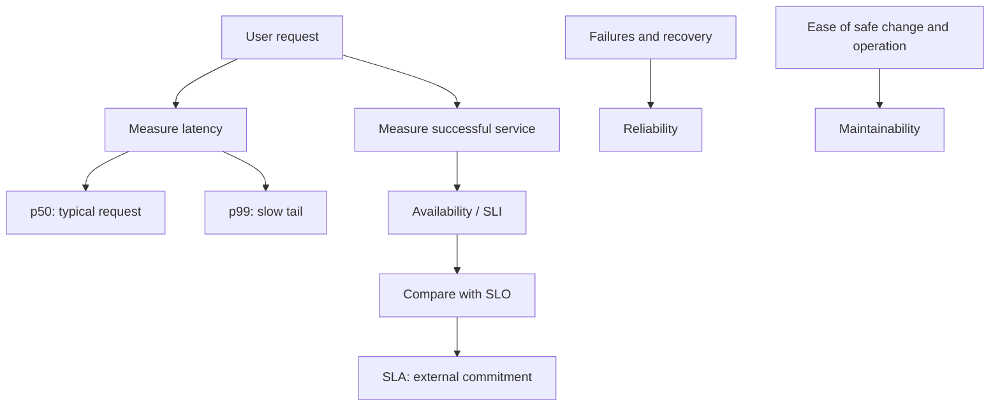
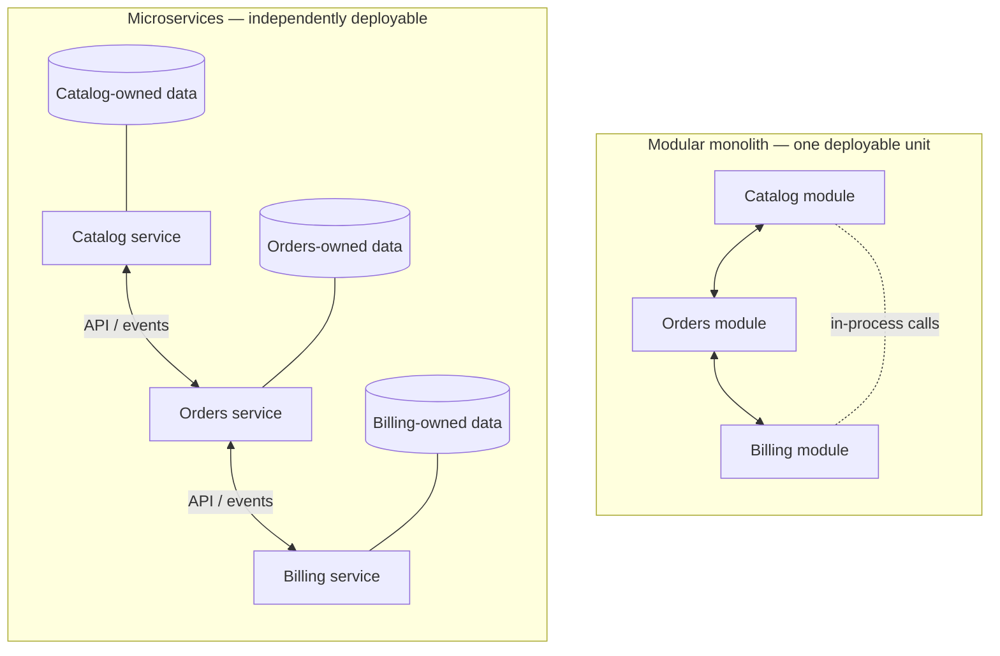
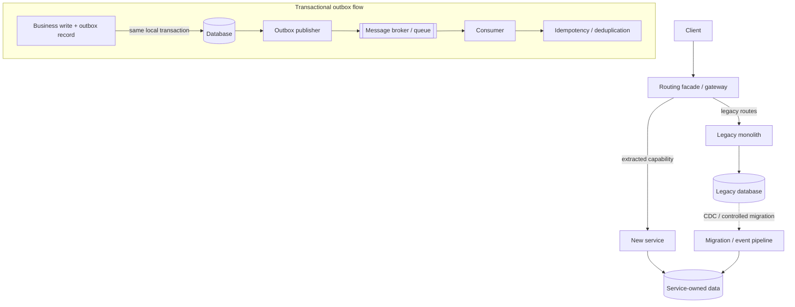
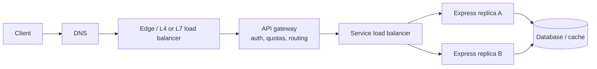
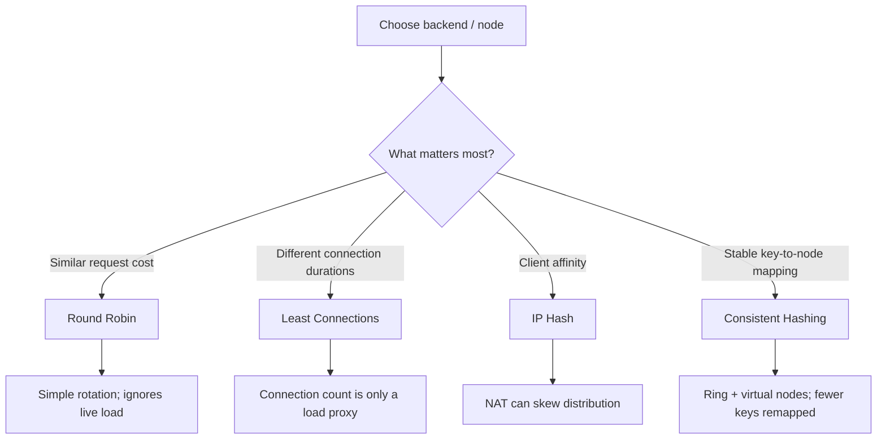
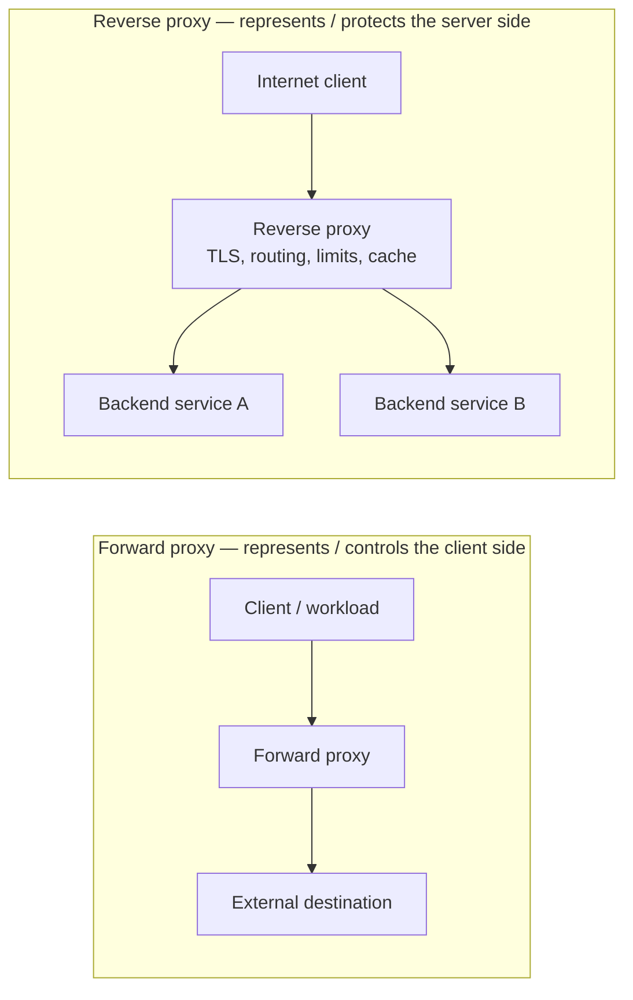

# Phase 1 — Foundational Concepts
## High-Level Design (HLD) Study Notes

**Audience:** Junior backend engineering interviews  
**Stack context:** Node.js, Express, MongoDB, Redis, message queues  
**Scope:** All six topics in Phase 1  
**How to use:** Read for understanding first; then redraw the diagrams from memory and answer the interview questions aloud.

> **Source boundary:** These notes are based on the Phase 1 syllabus supplied by the learner. The syllabus lists topics but does not include lecture transcripts or instructor-specific examples. Explanations and examples below are additional technical clarification, not claims about what a particular instructor said.

---

# 1. HLD Metrics: Latency, Availability, Reliability, Maintainability

## 1.1 Latency and percentiles

**Latency** is the elapsed time between an operation being initiated and its result being observed. For an API, it is commonly measured from request receipt to response completion. Be explicit about the measurement boundary: client-observed latency can include DNS, connection setup, TLS, network travel, server processing, and response transfer; server-side latency may measure only part of this.

- **p50 (median):** 50% of measured requests completed at or below this time.
- **p95:** 95% completed at or below this time.
- **p99:** 99% completed at or below this time; 1% took longer.
- **p99.9:** 99.9% completed at or below this time.

Example: `p50 = 40 ms, p99 = 700 ms` means the typical request is fast, but a tail of requests is much slower. The mean alone can hide this. Tail latency matters for user experience and fan-out systems: if a request waits for many downstream calls, a single slow dependency can dominate the total response time.

**Common latency contributors:** network RTT, TLS handshake, queueing, CPU work, database queries, lock contention, cache misses, garbage collection, downstream service calls, and overloaded connection pools.

**Ways to improve latency:** measure first; inspect traces and histograms; optimize slow queries and indexes; cache suitable reads; reduce unnecessary network hops; bound queues; use connection pooling; avoid excessive synchronous fan-out; scale bottlenecked resources. Caching is not automatically correct: it introduces freshness and invalidation concerns.

## 1.2 Availability and SLA mathematics

**Availability** is the fraction of a defined period in which a service is usable according to a stated measurement and success criterion.

\[
Availability = \frac{Total\ time - Downtime}{Total\ time} \times 100\%
\]

An **SLA** is a contractual or service commitment; an **SLO** is an internal or published target; an **SLI** is the measured indicator (for example, successful requests divided by eligible requests). They are related but not interchangeable.

Approximate maximum downtime for a 30-day month (43,200 minutes):

| Availability target | Downtime fraction | Approx. downtime per 30-day month |
|---|---:|---:|
| 99% | 1% | 7 h 12 min |
| 99.9% | 0.1% | 43 min 12 sec |
| 99.99% | 0.01% | 4 min 19.2 sec |
| 99.999% | 0.001% | 25.92 sec |

For a 365-day year, 99.999% allows about **5.256 minutes** of downtime (365 × 24 × 60 × 0.00001). Always state the measurement window and rounding assumptions. Real SLAs may exclude scheduled maintenance or define availability using request success rather than wall-clock uptime.

**Availability is not the same as reliability.** Availability asks whether the service is usable at a point in time / over a period. Reliability asks whether it continues to perform correctly without failure over a specified period. A system can recover quickly from frequent failures and have high availability but lower reliability.

### Combining dependencies (simplified model)

For independent components all required for a request, end-to-end availability is approximately the product of their availabilities. If three required services each have 99.9% availability:

`0.999 × 0.999 × 0.999 ≈ 0.997003`, or about **99.7003%**.

This is a simplified model: independence and a strict all-components-required path are assumptions. Redundancy, failover, shared dependencies, correlated failures, and graceful degradation change the result. Adding components can reduce reliability unless the architecture manages those dependencies.

## 1.3 Reliability

**Reliability** is the probability that a system performs its required function without failure for a specified duration and operating conditions. Engineering practice improves it through fault prevention, fault detection, containment, recovery, and graceful degradation.

Useful concepts:
- **MTBF:** mean time between failures (commonly for repairable systems).
- **MTTR:** mean time to repair/recover, depending on the organization’s definition.
- **Redundancy:** alternate components or paths that can take over.
- **Fault tolerance:** continued acceptable operation despite certain faults.
- **Graceful degradation:** preserve core functionality when optional capabilities fail.

Reliability practices include timeouts, retries with exponential backoff and jitter, circuit breakers, bulkheads, health checks, load shedding, durable queues, idempotent handlers, backups, tested restoration, and chaos/failure testing. Retries can amplify overload; retry only when appropriate, bound attempts, and use idempotency where duplicate execution is possible.

## 1.4 Maintainability

**Maintainability** is how easily and safely a system can be understood, changed, tested, deployed, and operated. It is affected by cohesion, coupling, code clarity, test coverage, observability, deployment complexity, documentation, and ownership.

A maintainable system is not necessarily the one with the most services or newest technology. Prefer the simplest architecture that satisfies current needs and can evolve safely. Clear module boundaries, automated tests, small deployable changes, structured logs, metrics, traces, and documented operational procedures all help.

### Backend example

An Express `GET /products/:id` endpoint is slow at p99. Traces show MongoDB query time dominates. Check query shape and indexes, connection-pool saturation, and data volume before adding Redis. If a downstream recommendation service is slow, set a timeout and consider returning the product without recommendations rather than allowing an optional dependency to take down the entire request.

### Diagram: How to think about HLD metrics

### Interview checks

1. What does p99 latency tell you that average latency may hide?
2. Calculate monthly downtime for 99.99% availability.
3. Explain the difference between an SLI, SLO, and SLA.
4. Can a service have high availability but poor reliability? Explain.
5. Why can adding dependencies reduce end-to-end availability?

---

# 2. Monolith vs Microservices

## 2.1 Monolithic architecture

A **monolith** packages an application as one deployable unit. It can still have well-separated internal modules. “Monolith” does not necessarily mean messy code, one process only, or one database; the defining trait is the deployment/runtime boundary.

**Advantages**
- Simple development and deployment path at small scale.
- Straightforward in-process calls and often simpler transactions.
- Easier local debugging and fewer distributed-systems failure modes.
- Lower infrastructure and operational overhead.

**Trade-offs**
- Modules can become tightly coupled if boundaries are weak.
- A change may require rebuilding and deploying the whole application.
- Scaling often scales the entire application even if only one module is hot.
- Large teams can conflict over code ownership and release coordination.

## 2.2 Microservices architecture

**Microservices** split a system into independently deployable services aligned with business capabilities. Services communicate over network APIs or asynchronous messaging and often own their data.

**Advantages**
- Independent deployment and scaling when boundaries are well chosen.
- Clearer team and service ownership.
- Failure and technology choices can be isolated to some degree.
- Teams can evolve services at different rates.

**Trade-offs**
- Network calls introduce latency, timeouts, partial failures, and serialization.
- Distributed data and transactions become harder.
- Requires service discovery/routing, observability, security, deployment automation, and operational maturity.
- Cross-service debugging and local development can become harder.
- Duplicated infrastructure and coordination overhead may outweigh benefits.

Microservices do not automatically improve performance, reliability, or team speed. Poorly split services can create a **distributed monolith**: many services with tight runtime coupling and coordinated releases.

## 2.3 Coupling and cohesion

- **Coupling:** how strongly one module depends on the details or behavior of another.
- **Cohesion:** how closely the responsibilities inside one module belong together.
- Aim for high cohesion and low coupling.
- **Temporal coupling:** two components must be available at the same time.
- **Data coupling:** components depend on shared data structures or databases.
- **Deployment coupling:** components must be released together.

A service boundary is useful when it protects a meaningful business capability and allows changes to happen with limited coordination. Merely splitting by technical layer (one service for controllers, one for database access) often creates excessive cross-service chatter.

## 2.4 Bounded contexts

In Domain-Driven Design, a **bounded context** is a boundary within which a domain model and its terminology have a specific, consistent meaning. The same word can mean different things in different contexts: “Customer” in Billing may have payment details, while “Customer” in Support may have support history.

A bounded context can be a module inside a monolith; it does not have to be a microservice. Use the concept to identify ownership, language, rules, and data boundaries before choosing deployment boundaries.

## 2.5 Conway’s Law

**Conway’s Law** observes that system designs tend to reflect the communication structures of the organizations that build them. If teams are split by business capabilities and have clear ownership, architecture may align with those boundaries. If every change requires several teams to coordinate, the architecture may mirror those communication bottlenecks.

This is a design consideration, not a deterministic law. Organizational structure, architecture, and communication practices influence one another.

## 2.6 Choosing between them

Prefer a modular monolith when the domain and team are small, boundaries are still evolving, or operational capacity is limited. Consider microservices when there are stable business boundaries, genuine independent scaling/deployment needs, clear ownership, and enough automation/observability to operate distributed systems.

### Backend example

Start an online store as a modular Express application with `catalog`, `orders`, and `billing` modules. Keep internal APIs explicit and avoid arbitrary cross-module database writes. If Orders later needs independent scaling and ownership, extract it behind a stable API or events. Do not split it solely because microservices are fashionable.

### Diagram: Modular monolith vs microservices

### Interview checks

1. Are microservices always more scalable?
2. What is a bounded context, and must it be a service?
3. Explain a distributed monolith.
4. How does Conway’s Law affect service boundaries?
5. What operational capabilities should exist before adopting microservices?

---

# 3. Monolith-to-Microservices Migration Patterns

Migration is an incremental risk-management problem, not simply moving files into separate repositories. The important questions are what to extract, how to route traffic, who owns data, and how to preserve correctness while both old and new implementations coexist.

## 3.1 Strangler Fig Pattern

The **Strangler Fig Pattern** incrementally replaces capabilities of a legacy system. A routing/facade layer sends selected requests to the old implementation or the new service. Over time, more behavior moves to the new path and the old path is retired.

Typical sequence:
1. Map the current behavior, data ownership, dependencies, and tests.
2. Put a routing boundary in place (gateway, reverse proxy, facade, or application router).
3. Choose a cohesive, low-risk capability.
4. Build the new service and define its API/data contract.
5. Route a limited percentage or subset of traffic to the new service.
6. Compare behavior, latency, errors, and data correctness.
7. Expand gradually; retain rollback capability.
8. Remove the old implementation only after dependencies and data flows are resolved.

**Risks:** inconsistent behavior between old and new paths, duplicated writes, hidden dependencies, and a long-lived migration layer. Define exit criteria and remove temporary routing once migration is complete.

## 3.2 Database decoupling

A common migration trap is extracting a service while both old and new code continue to write the same database tables. This creates shared-schema coupling: either side can break the other, ownership is unclear, and independent evolution is limited.

A safer target is **service-owned data**: each service owns its schema or data model and exposes capabilities through APIs/events. Moving to this target requires a migration plan, not only a new service process.

Potential approaches:
- **Expand–migrate–contract:** add compatible schema/fields, deploy code that can handle old and new representations, backfill/migrate data, switch reads/writes, then remove old structures.
- **API-mediated access:** the owning service performs reads/writes instead of other services directly accessing its tables.
- **Event-driven propagation:** publish domain events and let other services maintain their own read models/projections.
- **CDC:** capture database changes from a transaction log or change stream and propagate them to downstream consumers.

## 3.3 Change Data Capture (CDC)

**CDC** detects inserts, updates, and deletes in a source data store and makes them available downstream. Log-based CDC reads the database’s change log/transaction log; other implementations may poll tables or use database change streams.

Example: a legacy Orders database emits order changes to a stream; a new Analytics service consumes them and builds a read model.

Important considerations:
- CDC provides change propagation; it does **not by itself** establish domain ownership or guarantee a correct service boundary.
- Events may be delivered at least once; consumers should be idempotent.
- Handle ordering within the defined key/partition where supported, duplicate events, schema evolution, replay, lag, deletes/tombstones, and backfills.
- A CDC pipeline can be delayed or fail; monitor replication lag and have recovery/reconciliation procedures.
- Do not assume a database commit and an unrelated message publish are atomic.

## 3.4 Transactional boundaries and the dual-write problem

A local database transaction can atomically update records within that database. It usually cannot atomically commit a write to a database and a publish to an external broker without additional coordination.

**Dual-write failure example:** an order is committed to MongoDB, then publishing `OrderCreated` fails. The order exists but downstream services never hear about it. If the event is published first and the DB write fails, consumers may act on an order that does not exist.

**Transactional outbox pattern:**
1. In one local DB transaction, write the business record and an outbox event record.
2. A publisher reads unsent outbox records and publishes them.
3. Mark/track publication; expect possible duplicates.
4. Consumers use idempotency/deduplication and durable processing.

The outbox makes the business write and event record atomic within the same database transaction. It does not make broker delivery exactly-once end-to-end; duplicate-safe consumers are still important.

**Saga:** for a business operation spanning multiple services, model a sequence of local transactions and compensating actions rather than assuming a global ACID transaction. Compensation is a business action, not always a perfect rollback.

### Backend example

Extract `Notifications` from an Express monolith. The monolith writes `OrderCreated` to an outbox in the same MongoDB transaction as the order (where transaction support and deployment configuration permit). A worker publishes it to a queue. Notification consumers deduplicate by event ID. Later, notifications can own their own storage and retry policy.

### Diagram: Strangler Fig migration and reliable event publishing

### Interview checks

1. Explain the Strangler Fig Pattern.
2. Why is sharing one database a form of coupling?
3. What is CDC, and what does it not solve?
4. Explain the dual-write problem and transactional outbox.
5. Why are idempotency and schema evolution important in event pipelines?

---

# 4. API Gateway vs Load Balancer

## 4.1 Load balancer

A **load balancer** distributes incoming connections or requests across healthy backend targets. Its main goals include utilization, throughput, resilience, and avoiding one target becoming overloaded.

- **Layer 4 (L4):** routes based mainly on transport/network information such as IP addresses, TCP/UDP ports, and connection state. It generally does not need to interpret HTTP paths or headers.
- **Layer 7 (L7):** understands application protocols such as HTTP and can route by host, path, headers, cookies, or other request attributes.

Examples of capabilities vary by product; “load balancer” is a role, not one fixed implementation.

## 4.2 API gateway

An **API gateway** is an API entry point that can route to services and enforce cross-cutting API policies, such as authentication/authorization, rate limits, request/response transformation, API version routing, quotas, and API-level logging.

An L7 load balancer can implement some gateway-like features, and a gateway often distributes traffic. The distinction is primarily responsibility and policy, not an absolute product boundary.

## 4.3 Request routing mechanics

A typical HTTP path:
1. DNS resolves the public service name to an edge/load-balancer address.
2. The client establishes a transport connection; HTTPS also establishes TLS.
3. An L4 balancer can select a target based on connection-level information.
4. An L7 proxy/gateway parses the HTTP request and matches routing rules (host/path/header).
5. The selected backend receives the request; the response travels back through the proxy path.

**Routing table examples:**
- `api.example.com/catalog/* → catalog-service`
- `api.example.com/orders/* → orders-service`
- `api.example.com/billing/* → billing-service`

A routing rule should include a default/unknown-route behavior and avoid leaking internal details in error responses.

## 4.4 TLS termination offloading

With **TLS termination**, the edge proxy completes the client TLS connection, decrypts the HTTP request, and forwards it upstream. This can centralize certificate management and reduce cryptographic work at application instances.

The upstream hop must still be protected according to the threat model. Use TLS to the backend when required, validate certificates, restrict network access, and preserve trustworthy client identity only through headers set/overwritten by the trusted proxy. Do not blindly trust client-supplied `X-Forwarded-For` or similar headers.

Alternative: TLS passthrough keeps TLS encrypted through the intermediary, which may then have less ability to inspect HTTP content. Re-encryption means terminating TLS at the edge and establishing another TLS connection upstream.

## 4.5 Avoid confusing the roles

| Concern | Load balancer | API gateway |
|---|---|---|
| Distribute traffic across healthy targets | Core responsibility | May do this too |
| L4 connection routing | Common capability | Usually not the primary API role |
| Route by HTTP path/host | L7 balancers can | Common capability |
| API authentication, quotas, version policies | Product-dependent | Common responsibility |
| Service-specific request transformation | Not always | Common capability |
| Health checks and target selection | Common capability | May integrate with routing/health checks |

### Backend example

A public L7 endpoint routes `/orders` to an Orders service and `/products` to a Catalog service. The gateway validates a JWT and applies per-user rate limits. The service-side load balancer distributes each route across healthy replicas. This is one possible deployment; the exact split depends on the platform.

### Diagram: Request path through gateway and load balancer

**TLS note:** TLS may terminate at the edge or gateway. If traffic is re-encrypted to the backend, validate the upstream connection and trust forwarded headers only from known proxies.

### Interview checks

1. What can L7 routing do that L4 routing generally cannot?
2. Is an API gateway always a load balancer?
3. What are the security implications of TLS termination?
4. Why should forwarded-client headers only be trusted from known proxies?

---

# 5. Load-Balancing Algorithms

A load-balancing algorithm selects a backend for each new request or connection according to a rule. The best choice depends on whether work is uniform, whether connection duration varies, and whether requests need affinity to a cache or session.

## 5.1 Round Robin (RR)

Maintain an ordered list of eligible targets and advance a pointer for each selection: A → B → C → A → B → C. Simple and fair when targets have similar capacity and requests have similar cost.

**Weighted Round Robin** gives more selections to higher-capacity targets. Plain RR does not account for active connections or request cost, so equal request counts do not guarantee equal CPU utilization.

## 5.2 Least Connections First (LC)

Select the healthy target with the fewest active connections. It can help when connections vary in duration, such as long-lived requests or sessions. Weighted least-connections variants account for different backend capacity.

Limitations: connection count is only a proxy for work. One connection can be idle while another consumes substantial CPU; short requests may finish before counts meaningfully reflect load. Health, queue depth, latency, and saturation signals may also be relevant.

## 5.3 IP Hash

Hash a client IP address and use the result to choose a backend. This can provide a form of affinity: the same source IP often maps to the same server while the backend set and hashing scheme remain stable.

Limitations:
- Many users behind one NAT/proxy can concentrate on one backend.
- A user's IP can change.
- Adding/removing targets may remap many clients with simple modulo hashing.
- It is not a secure identity mechanism and should not replace authentication.

## 5.4 Consistent Hashing

A consistent-hashing ring maps both backend nodes and keys to a circular hash space. Each key is assigned to the first node encountered clockwise from the key's hash (implementation conventions may vary).

Adding/removing a node generally remaps only a portion of keys rather than almost all keys as with naive `hash(key) % N` modulo placement. **Virtual nodes (vnodes)** place multiple positions per physical node on the ring to improve distribution and allow weighted capacity.

Conceptual example:
1. Hash each server identity to one or more ring positions.
2. Hash the key (for example, a cache key or tenant ID).
3. Walk clockwise to the first node position.
4. Store/read the key at that node.
5. When a node changes, remap the key range whose ownership changed; replicate/migrate data as the system requires.

Consistent hashing is useful for cache partitioning and some affinity/routing problems. It is not automatically the best general-purpose HTTP load balancer: a hot key can create a hotspot, and the system still needs health handling, replication, and rebalancing.

## 5.5 Comparison

| Algorithm | Selection basis | Strength | Main limitation |
|---|---|---|---|
| Round Robin | Next target in sequence | Simple, even distribution for similar work | Ignores live load |
| Least Connections | Active connection count | Handles varied connection durations better | Connections are an imperfect load signal |
| IP Hash | Client IP hash | Client affinity | NAT skew and remapping |
| Consistent Hashing | Key position on ring | Limited remapping on membership change | Hot keys and ring/replication complexity |

### Practical choice

- Uniform stateless API requests across similar instances: Round Robin may be sufficient.
- Long-lived connections with varying duration: Least Connections may help.
- Need stable client affinity: IP Hash may be appropriate, with caveats.
- Need key-to-node stability across cache/shard membership changes: Consistent Hashing is often relevant.

### Diagram: Choosing a load-balancing algorithm

### Interview checks

1. Why can Round Robin be unfair when request costs vary?
2. Why does Least Connections not perfectly measure CPU load?
3. What are the risks of IP Hash behind NAT?
4. Explain why consistent hashing remaps fewer keys than modulo hashing.
5. What do virtual nodes improve, and what do they not solve?

---

# 6. Forward Proxy vs Reverse Proxy

A **proxy** intermediates communication between a client and another server. The key distinction is which side the proxy represents and whose routing/policy it controls.

## 6.1 Forward proxy

A forward proxy sits on the client side. Clients are configured to send outbound requests through it, often for egress policy, access control, logging, content filtering, or privacy from destination servers.

- The destination generally sees the proxy's outbound IP, not the original client IP, unless identity is otherwise revealed.
- The proxy operator can still observe metadata and, depending on TLS setup, possibly content.
- It is not a guarantee of anonymity or encryption by itself.
- Organizations may use forward proxies to restrict which external destinations workloads can reach.

## 6.2 Reverse proxy

A reverse proxy sits in front of servers and represents the server side to clients. Clients connect to the proxy, which forwards requests to one or more origin/backend servers.

Common responsibilities:
- Edge routing and load balancing.
- TLS termination and certificate management.
- Authentication integration, request limits, and filtering.
- Compression and caching.
- Hiding internal topology and providing a controlled entry point.
- Health-aware routing, depending on the implementation.

Examples include Nginx and HAProxy when configured as reverse proxies. Their precise capabilities depend on configuration and modules.

## 6.3 Routing and caching topologies

A typical reverse-proxy topology:

`Client → DNS / Edge → Reverse Proxy → Backend service(s) → Database/cache`

A forward-proxy topology:

`Client/workload → Forward Proxy → Internet/destination server`

**Caching:** a reverse proxy can cache eligible responses close to the application; a CDN caches at geographically distributed edge locations; a forward proxy may cache outbound resources for a client organization. Caching depends on HTTP semantics and policy, including `Cache-Control`, `Vary`, authorization, cookies, freshness, and invalidation. Do not cache personalized or sensitive responses as shared content unless the cache key and policy make it safe.

## 6.4 Security considerations

- Keep internal backend ports private where possible.
- Apply request size/time limits and rate limits at appropriate boundaries.
- Configure trusted proxy hops; do not trust arbitrary client-supplied forwarding headers.
- Decide where TLS terminates and whether upstream traffic is re-encrypted.
- Prevent open-proxy configurations that allow unauthorized relaying.
- Ensure caches do not leak one user's response to another.

### Backend example

Nginx accepts HTTPS for `api.example.com`, terminates TLS, and routes `/orders` to an Express service pool. It may cache public, cacheable product metadata. It should not blindly cache an authenticated `/account` response. A corporate forward proxy is a different component: it controls a developer workstation's outbound access to external sites.

### Diagram: Forward proxy and reverse proxy

### Interview checks

1. Which proxy represents the client, and which represents the server?
2. Does a forward proxy guarantee anonymity?
3. How can a reverse proxy improve security without replacing application authorization?
4. What can go wrong when caching personalized responses?
5. Why must forwarded headers be handled carefully?

---

# Cross-topic revision map

- **Metrics** tell you what to measure and what users experience.
- **Architecture style** defines module/service and ownership boundaries.
- **Migration patterns** help change those boundaries safely over time.
- **Gateways and load balancers** control how traffic reaches the right target.
- **Load-balancing algorithms** choose among targets or map keys to nodes.
- **Proxies** define the intermediary's position, policy role, and caching opportunities.

## Final Phase 1 self-test

Before moving to Phase 2, try to explain without notes:

- [ ] p99 latency and 99.999% downtime math.
- [ ] Availability vs reliability vs maintainability.
- [ ] When a modular monolith is preferable to microservices.
- [ ] Bounded contexts and Conway's Law.
- [ ] Strangler Fig, CDC, dual writes, and outbox.
- [ ] L4 vs L7, API gateway responsibilities, and TLS termination.
- [ ] RR vs Least Connections vs IP Hash vs Consistent Hashing.
- [ ] Forward vs reverse proxy and safe cache behavior.

**Accuracy reminder:** Architecture choices are contextual. State assumptions, failure modes, and trade-offs in interviews rather than presenting one tool or pattern as universally best.
