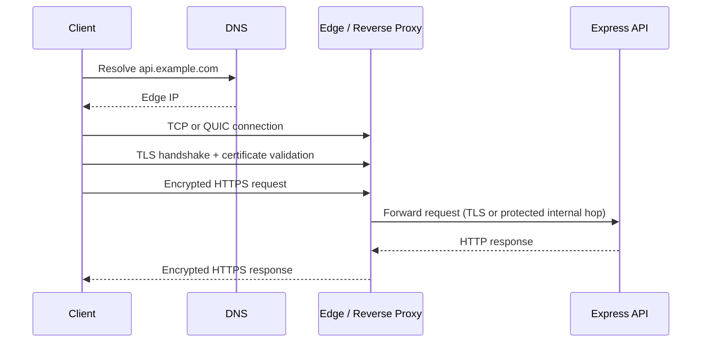
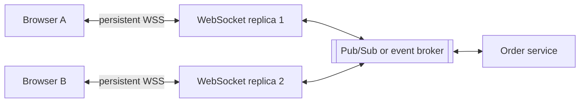
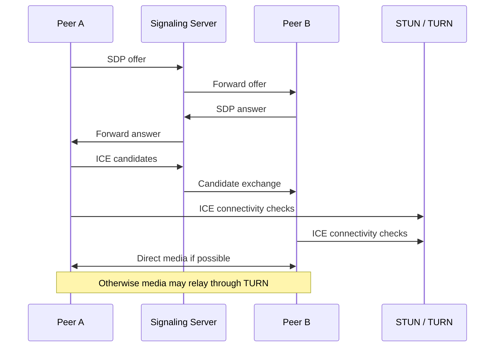
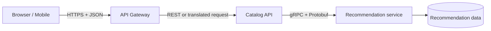
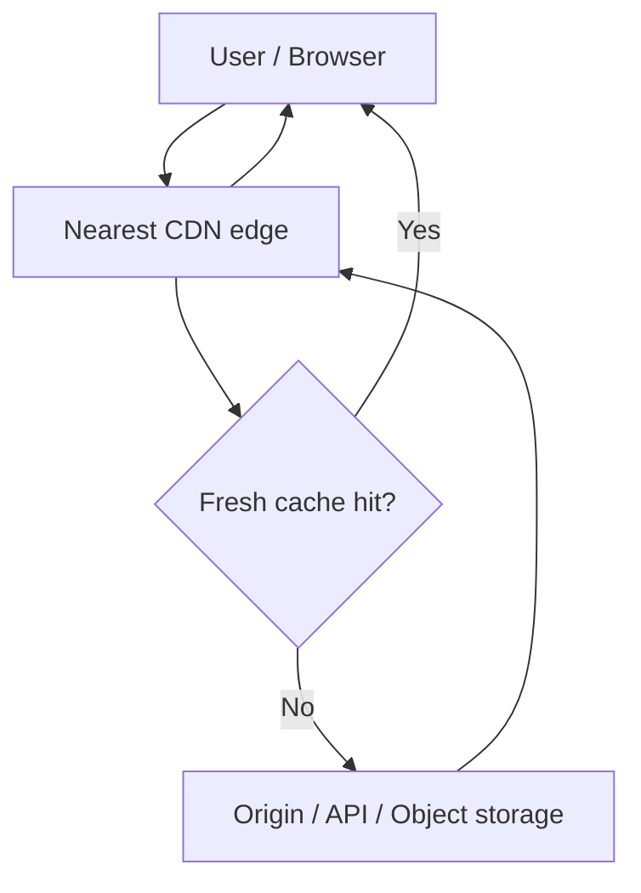
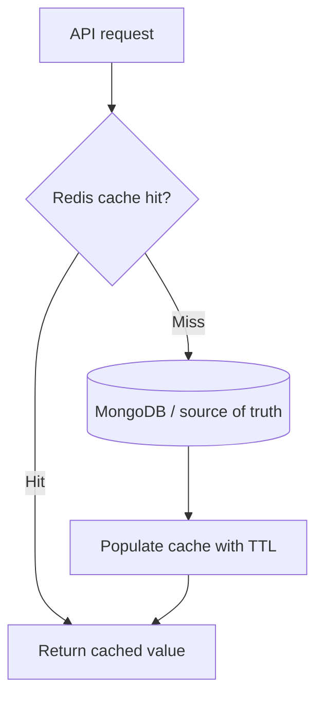
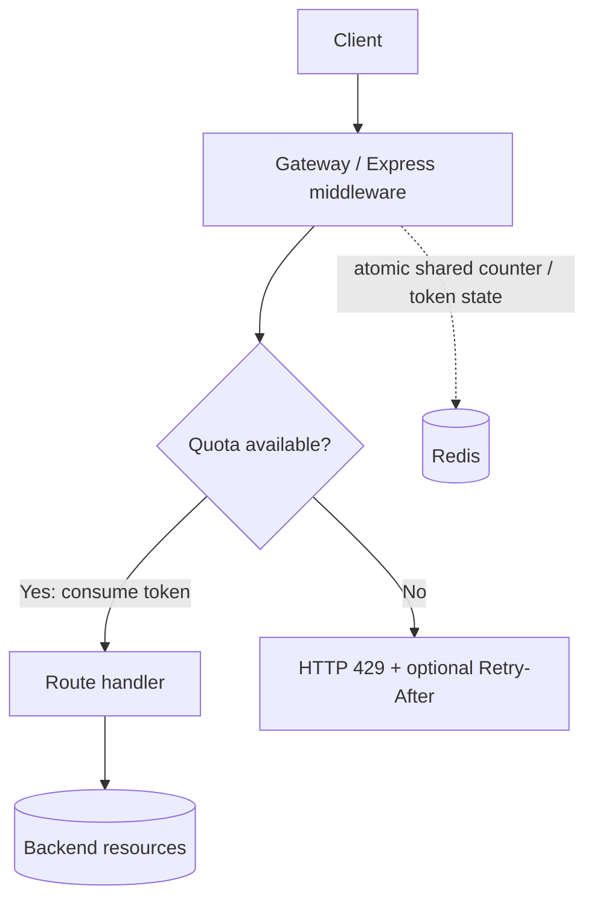
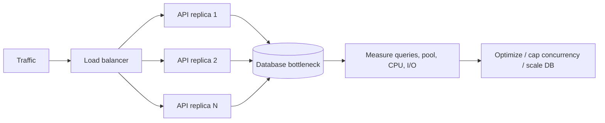

# Phase 2 — Networking & Protocols
## High-Level Design (HLD) Study Notes + Diagrams

**Audience:** Junior backend engineering interviews  
**Stack context:** Node.js, Express, MongoDB, Redis, message queues  
**Phase workflow:** Understand the concepts, redraw each diagram from memory, then answer the interview checks aloud.

> **Scope note:** These notes follow the Phase 2 topic list available from your HLD study plan: HTTPS, WebSockets, WebRTC, REST vs gRPC, CDN, caching, rate limiting, and scaling. The explanations and examples are technical study material, not quotations from a specific lecture.

---

# 1. HTTPS and TLS

## What it is
**HTTPS** is HTTP carried over TLS. TLS provides encryption in transit, integrity protection, and authentication of the server (and optionally the client with mutual TLS). HTTPS does not by itself prove that an application is safe or that a user is authorized.

## Typical connection flow
1. The client resolves the hostname through DNS and establishes a TCP connection for HTTP/1.1 or HTTP/2. HTTP/3 uses QUIC over UDP.
2. The client and server perform a TLS handshake. The server presents a certificate; the client validates the certificate chain, hostname, validity, and trust.
3. The peers negotiate cryptographic parameters and establish session keys.
4. HTTP requests and responses travel inside the encrypted channel.

## Key terms
- **TLS certificate:** binds a public key to a hostname/identity, signed by a trusted certificate authority or another configured trust anchor.
- **TLS termination:** a proxy or load balancer decrypts the client-side TLS connection.
- **Re-encryption:** the proxy establishes a separate TLS connection to the backend.
- **mTLS:** both client and server authenticate with certificates, often for service-to-service communication.
- **HSTS:** tells supporting browsers to use HTTPS for a domain for a specified period.
- **Certificate renewal:** automate it where possible and monitor expiry.

## Backend example
A client calls `https://api.example.com/orders`. A public reverse proxy terminates TLS and routes the request to an Express service. If the internal network is not fully trusted, use TLS on the upstream hop too. Only trust forwarded headers such as `X-Forwarded-For` when they are overwritten or appended by known proxies and the proxy chain is configured correctly.

## Common pitfalls
- Treating HTTPS as authorization; application permissions are still required.
- Disabling certificate verification to “fix” TLS errors.
- Assuming traffic is encrypted after TLS terminates at the edge.
- Trusting arbitrary client-supplied forwarded headers.
- Forgetting certificate expiry, hostname mismatch, or incorrect system time.

### Diagram: HTTPS request path

### Interview checks
1. What does TLS provide, and what does it not provide?
2. What is the difference between TLS termination and re-encryption?
3. Why is disabling certificate validation dangerous?
4. Why should `X-Forwarded-For` not be trusted from arbitrary clients?

---

# 2. WebSockets

## What it is
**WebSocket** provides a persistent, bidirectional connection between a client and server. After an HTTP-based opening handshake, both sides can send messages over the same connection without initiating a new HTTP request for every message.

## When to use it
- Chat and presence updates.
- Live dashboards and collaborative editing.
- Multiplayer game state or interactive notifications.
- Streaming frequent server updates where request/response polling is inefficient.

For occasional updates, ordinary HTTP polling or Server-Sent Events (SSE) may be simpler. WebSockets add connection lifecycle, scaling, and delivery concerns.

## Connection lifecycle
1. Client requests a WebSocket upgrade over HTTP (commonly `ws://` or encrypted `wss://`).
2. Server accepts the upgrade.
3. The connection stays open; either side can send frames.
4. Heartbeats can detect stale connections.
5. Disconnects are normal; clients may reconnect with backoff.

## Scaling and correctness
- A load balancer/proxy must support WebSocket upgrades and long-lived connections.
- Many concurrent connections consume file descriptors, memory, and per-connection state.
- Multiple application replicas need a fan-out strategy: a broker/pub-sub layer can distribute events to the replica holding each client connection.
- A reconnect can miss events unless the protocol includes cursors, sequence IDs, replay, or a snapshot/resync strategy.
- Do not assume exactly-once delivery. Define acknowledgements, idempotency, ordering, and authorization if the product needs them.
- Authenticate the handshake and authorize subscriptions; validate message size/rate and avoid trusting client-provided room IDs.

## Backend example
A Node.js service keeps WebSocket connections for live order status. Order updates are published to Redis Pub/Sub or a message broker, and each replica forwards relevant events to its connected clients. For durable replay, use a persistent event log or query the current order state after reconnect; Pub/Sub alone is not a durable history.

### Diagram: WebSocket fan-out

### Interview checks
1. How is WebSocket different from normal HTTP request/response?
2. Why can multiple WebSocket replicas need pub/sub?
3. What happens if a client disconnects while an event is published?
4. When might SSE be simpler than WebSockets?

---

# 3. WebRTC

## What it is
**WebRTC** enables real-time audio, video, and data communication between browsers or supported clients. Media often travels directly peer-to-peer, but network conditions may require a relay server.

WebRTC does **not** eliminate the need for a signaling mechanism. Signaling exchanges session descriptions and network candidates; the application chooses how to implement it, commonly using HTTPS and/or WebSockets.

## Main pieces
- **Signaling:** exchanges SDP offers/answers and ICE candidates; not prescribed as one specific transport by WebRTC.
- **SDP:** describes media formats and session parameters.
- **ICE:** gathers and tests candidate network paths.
- **STUN:** helps a peer discover its public-facing network address and assists connectivity checks.
- **TURN:** relays traffic when a direct path cannot be established; it costs bandwidth and infrastructure.
- **DTLS-SRTP:** protects WebRTC data/media transport according to the negotiated WebRTC stack.

## Typical call setup
1. Peer A creates an offer and sends it through signaling.
2. Peer B returns an answer through signaling.
3. Both peers exchange ICE candidates.
4. ICE connectivity checks choose a workable path.
5. Media/data flows directly if possible, or through TURN when needed.

## Architecture trade-offs
- Peer-to-peer can reduce server media bandwidth for small calls, but connectivity is not guaranteed.
- Group video often uses an **SFU** (Selective Forwarding Unit), which receives streams and forwards selected streams to participants. An MCU mixes media; it can require more server processing.
- TURN capacity, geographic placement, privacy, NAT/firewall behavior, packet loss, jitter, and bandwidth all matter.
- Signaling is application logic; WebRTC handles real-time transport once the session is negotiated.

## Backend example
A Node.js signaling service authenticates users and relays offer/answer/candidate messages. STUN/TURN services help peers establish a path. For a multi-person meeting, a managed or self-hosted SFU may be more practical than a full mesh where every participant sends media to every other participant.

### Diagram: WebRTC call setup

### Interview checks
1. Why does WebRTC still need signaling?
2. What is the difference between STUN and TURN?
3. What is an SFU, and why use one for group calls?
4. What factors can prevent a direct peer-to-peer connection?

---

# 4. REST vs gRPC

## REST
REST is an architectural style commonly used with HTTP resources and representations. In typical web APIs, resources are identified by URLs and manipulated using methods such as GET, POST, PUT, PATCH, and DELETE. JSON is common but not required by REST.

Strengths: broad browser/tool compatibility, human-readable payloads, straightforward HTTP caching semantics for suitable requests, and easy inspection with common tools.

## gRPC
gRPC is an RPC framework that commonly uses Protocol Buffers for schema-defined messages and HTTP/2 as its transport. It supports unary calls and streaming patterns (client, server, and bidirectional streaming, depending on the language/runtime).

Strengths: compact binary messages, generated clients, explicit contracts, and efficient service-to-service communication. Trade-offs include schema/tooling requirements, browser constraints (often requiring gRPC-Web or a proxy), and less convenient manual inspection than JSON APIs.

## Comparison

| Dimension | REST-style HTTP API | gRPC |
|---|---|---|
| Interaction model | Resource-oriented | Procedure / method call |
| Common payload | JSON | Protocol Buffers |
| Contract | OpenAPI is common, but not mandatory | `.proto` schema |
| Browser support | Native and broad | Often needs gRPC-Web/proxy |
| Streaming | Possible with SSE/WebSockets/other HTTP patterns | Built-in RPC streaming patterns |
| Human debugging | Usually easier | Often needs tooling |
| Good fit | Public APIs, browser/mobile integrations | Internal service-to-service APIs, streaming RPC |

## Decision guidance
Choose based on clients, compatibility, tooling, payload, latency, and streaming requirements—not on a universal claim that one is always faster. Measure real workloads. Both need authentication, authorization, timeouts, retries, observability, and versioning discipline.

## Backend example
A public storefront API may expose `GET /products/123` as REST/JSON. An internal Recommendation service may use gRPC with generated types and deadlines. A gateway can expose a browser-friendly REST endpoint while calling internal gRPC services.

### Diagram: REST edge and gRPC internal call

### Interview checks
1. Is REST the same thing as JSON over HTTP?
2. What does a `.proto` file provide?
3. When is gRPC streaming useful?
4. Why might a public browser API use REST while internal services use gRPC?

---

# 5. CDN (Content Delivery Network)

## What it is
A **CDN** is a geographically distributed network of edge locations that serves cacheable content closer to users. It can reduce latency and origin load and may provide TLS termination, traffic filtering, DDoS mitigation, and edge logic depending on the provider.

## Typical request flow
1. The browser requests a static asset or cacheable response.
2. DNS/routing sends the request to an appropriate CDN edge.
3. If the edge has a fresh cache entry (**cache hit**), it responds immediately.
4. If not (**cache miss**), it fetches from the origin, may cache the response according to policy, and returns it.
5. The cache key and freshness policy determine whether later requests can reuse the response.

## What belongs on a CDN?
Often: versioned JavaScript/CSS, images, fonts, downloads, public product imagery, and carefully configured public API responses.

Be cautious with: personalized pages, authenticated responses, private data, cookies, and content whose cache key does not include all relevant variation. CDN caching must respect HTTP cache directives and provider configuration.

## Important controls
- **TTL / freshness:** how long an object may be reused.
- **Cache key:** dimensions used to identify an object (host, path, query parameters, selected headers/cookies where configured).
- **Purge/invalidation:** remove or expire stale objects.
- **Origin shield:** an intermediate cache that reduces repeated origin fetches.
- **Versioned assets:** filenames with content hashes make cache invalidation easier.
- **Stale-while-revalidate:** may serve a stale object while refreshing, where supported and configured.

## Backend example
Serve hashed frontend assets from a CDN with a long TTL. Keep a user's `/account` response private and non-shared-cacheable. Public catalog responses may be cached only if the cache key and freshness rules reflect the product's update needs.

### Diagram: CDN cache hit and miss

### Interview checks
1. What happens on a CDN cache hit versus a miss?
2. Why are hashed static asset filenames useful?
3. What can go wrong if a CDN caches personalized content?
4. How do TTL and invalidation differ?

---

# 6. Caching

## What it is
A **cache** stores a reusable copy of data so a later request can be served faster or with less load on the source. Caches trade reduced latency/load for freshness, invalidation, memory, and consistency complexity.

## Common cache locations
- Browser cache.
- CDN / edge cache.
- Reverse-proxy cache.
- Application cache (for example, Redis).
- Database buffer/query caches (implementation-dependent).

## Cache-aside pattern
1. Application checks the cache.
2. On hit, return the cached value.
3. On miss, read the database.
4. Store the result in cache with an appropriate TTL.
5. Return the result.

**Write behavior:** the application usually updates the database and then invalidates or updates the cache. The exact ordering and failure handling matter; a simple delete can race with a concurrent stale read, so high-stakes correctness may need stronger coordination.

## Other patterns
- **Read-through:** cache layer loads missing data from the source.
- **Write-through:** writes go through the cache and are synchronously propagated to the source, depending on implementation.
- **Write-behind / write-back:** cache accepts writes and propagates later; faster in some cases but creates durability and data-loss risks if not designed carefully.
- **Refresh-ahead:** refresh entries before they expire when access patterns justify it.

## Failure modes and mitigations
- **Cache stampede:** many requests recompute/fetch an expired hot key simultaneously. Mitigate with request coalescing/single-flight, jittered TTLs, locks used carefully, or stale-while-revalidate.
- **Cache penetration:** repeated requests for missing keys hit the database. Consider short negative caching, input validation, or Bloom filters for suitable workloads.
- **Hot key:** one key receives disproportionate traffic. Replicate, shard, precompute, or apply per-key strategies.
- **Stale data:** choose TTL/invalidation based on the business freshness requirement.
- **Cache outage:** avoid sending unlimited traffic to the database; use bounded concurrency, circuit breaking, load shedding, and fallback policies.

## Backend example
For `GET /products/:id`, use Redis cache-aside with a short TTL if slight staleness is acceptable. Invalidate the key after product updates. Never assume a cache is the source of truth unless the system explicitly designs it that way.

### Diagram: Cache-aside read

### Interview checks
1. Explain cache-aside.
2. Why is cache invalidation difficult?
3. What is a cache stampede, and how can you reduce it?
4. Why should the database remain protected during a cache outage?

---

# 7. Rate Limiting

## What it is
**Rate limiting** controls how many requests or operations a client can perform in a time interval. It protects service capacity, helps enforce quotas, and reduces abuse. It is not the same as authentication or authorization.

## Common algorithms
- **Fixed window counter:** count requests per fixed time bucket. Simple, but bursts can occur around bucket boundaries.
- **Sliding window log:** record request timestamps and count those in the active interval. Accurate but potentially memory/compute intensive.
- **Sliding window counter:** approximate a sliding window by combining current and previous bucket counts.
- **Token bucket:** tokens refill at a configured rate up to a capacity; each request consumes tokens. Allows controlled bursts.
- **Leaky bucket:** processes at a steadier rate, smoothing bursts depending on implementation.

## Where to enforce it
- Edge/CDN/WAF for broad IP-based protection.
- API gateway for API keys, users, tenants, or routes.
- Application/service for business-specific limits.
- Shared storage such as Redis when multiple replicas must coordinate a global or per-identity limit.

## Distributed implementation considerations
- Define the key: user ID, API key, tenant, IP, endpoint, or a combination.
- Avoid using IP alone for authenticated users; NAT can group many users and IPs can change.
- Use atomic Redis operations or scripts for counter/token updates to avoid race conditions.
- Define fail-open versus fail-closed behavior if the limiter store is unavailable.
- Return HTTP `429 Too Many Requests`; use `Retry-After` when meaningful.
- Use separate concurrency limits for expensive long-running work; request rate alone does not bound in-flight work.

## Backend example
An Express API allows 100 requests per minute per authenticated user, with a stricter limit for `/login`. All replicas use a shared Redis-backed limiter so a user cannot bypass the limit by landing on a different replica. Login protection should also consider credential stuffing, IP/device signals, and account-level controls.

### Diagram: Request through a rate limiter

### Interview checks
1. Why can fixed-window counters allow bursts at boundaries?
2. How does token bucket differ from leaky bucket?
3. Why use Redis or another shared store across API replicas?
4. What is the trade-off between fail-open and fail-closed?

---

# 8. Scaling: Vertical, Horizontal, and Capacity

## What it means
**Scaling** increases the capacity of a system as demand grows. Capacity planning should use measurements—throughput, latency percentiles, saturation, error rate, queue depth, and resource utilization—not guesses alone.

## Vertical scaling
Give one machine more CPU, memory, disk, or network capacity. It is often simpler and can be a good first step, but hardware limits, cost curves, and single-node failure remain.

## Horizontal scaling
Add more instances and distribute traffic. It improves capacity and can improve availability when redundancy and failure handling are designed correctly. Stateless services are easier to scale horizontally; session state should generally be externalized or handled with deliberate affinity.

## Bottlenecks and backpressure
A service's throughput is limited by the bottleneck: CPU, database, connection pool, external dependency, locks, queue consumers, or network. Adding API replicas may simply overload MongoDB if the database is already saturated.

- **Load shedding:** reject lower-priority work when overloaded.
- **Backpressure:** slow or limit producers when consumers cannot keep up.
- **Queue-based smoothing:** buffer bursts, while watching queue age/depth and processing deadlines.
- **Autoscaling:** add/remove capacity from measured signals, with cooldowns and sufficient startup headroom.
- **Statelessness:** externalize durable session/state where practical.
- **Database scaling:** indexes, query optimization, read replicas, partitioning/sharding, and connection-pool limits may be needed depending on the bottleneck.

## Little’s Law (useful relationship)
For a stable system, **L = λW**:
- `L` = average number of items in the system (for example, in-flight requests),
- `λ` = average arrival/completion rate,
- `W` = average time in the system.

If throughput remains 200 requests/second and average time in the system is 0.25 seconds, average in-flight work is approximately `200 × 0.25 = 50`. This is a relationship, not a sizing guarantee; bursts and tail latency still matter.

## Backend example
A Node.js API is CPU-light but MongoDB connections are saturated. Increasing the number of Express replicas can increase database connection pressure and worsen latency. First inspect query latency, indexes, pool sizes, and database capacity; scale the actual bottleneck and cap concurrency to protect dependencies.

### Diagram: Scale the bottleneck, not just the API

### Interview checks
1. What is the difference between vertical and horizontal scaling?
2. Why can adding application replicas make a database bottleneck worse?
3. Explain backpressure and load shedding.
4. Use Little’s Law to estimate in-flight requests for 500 req/s at 100 ms average latency.
5. Why is statelessness helpful for horizontal scaling?

---

# Phase 2 — Cross-topic revision map

- **HTTPS/TLS** protects data in transit and establishes server identity.
- **WebSockets** provide persistent bidirectional messaging.
- **WebRTC** supports real-time peer media/data and needs signaling plus ICE connectivity.
- **REST vs gRPC** is an API interaction and tooling choice.
- **CDNs and caches** reduce latency/origin load but introduce freshness and privacy concerns.
- **Rate limiting** controls request pressure and quotas.
- **Scaling** adds capacity, but only if the true bottleneck is addressed.

## Final Phase 2 self-test

Before moving to Phase 3, explain these without notes:

- [ ] HTTPS, certificate validation, TLS termination and re-encryption.
- [ ] WebSocket lifecycle, fan-out across replicas, reconnect and replay.
- [ ] WebRTC signaling, SDP, ICE, STUN, TURN, SFU.
- [ ] REST vs gRPC and when to choose each.
- [ ] CDN cache hit/miss, TTL, cache key, invalidation.
- [ ] Cache-aside, stampede, hot keys, stale data and cache outages.
- [ ] Fixed window, sliding window, token bucket and distributed limiting.
- [ ] Vertical/horizontal scaling, bottlenecks, backpressure and Little’s Law.

**Interview habit:** state the requirements and assumptions first, then explain the flow, failure modes, trade-offs, and why you chose the design.
