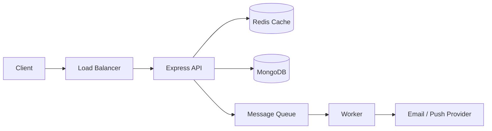
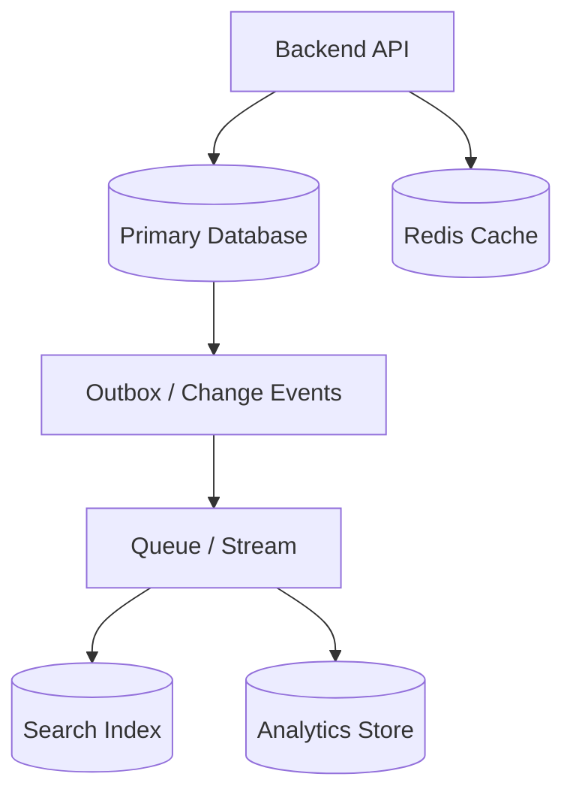
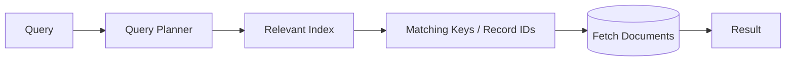
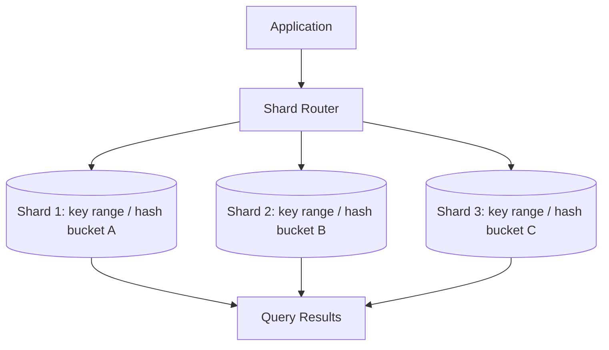
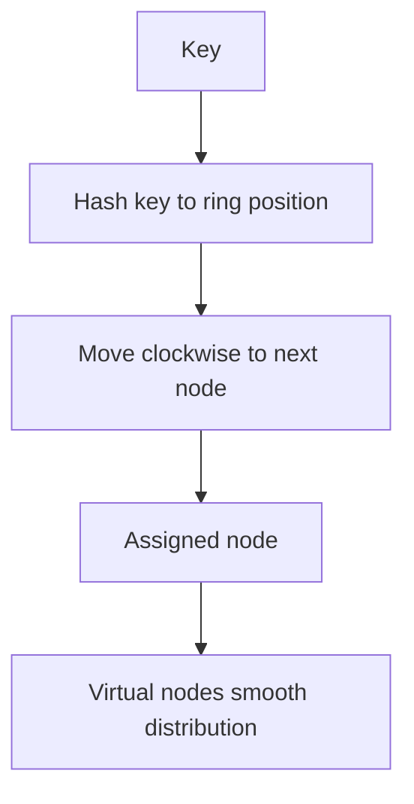
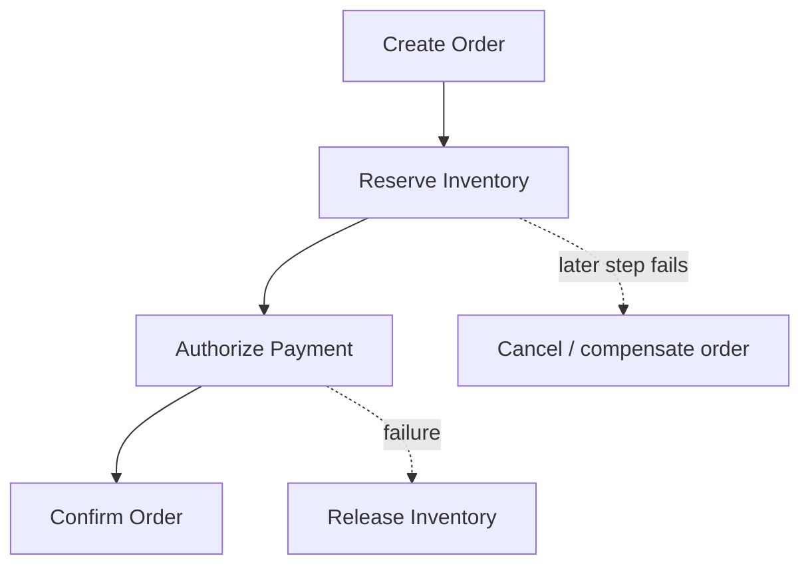
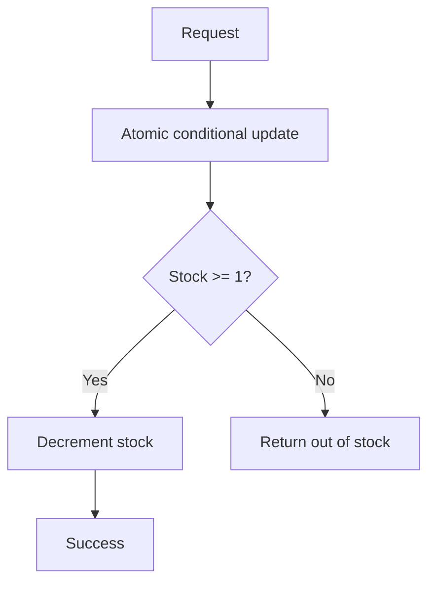

# HLD Phase 3 — Data & Distributed Systems
## Revision notes for junior backend engineering interviews

**Stack context:** Node.js, Express, MongoDB, Redis, and message queues  
**Goal:** Understand the design choices, trade-offs, failure modes, and interview reasoning behind data-intensive backend systems.

> **How to study:** Read one topic, redraw its diagram from memory in Excalidraw, then explain the trade-offs aloud. These notes use general backend engineering knowledge to expand the phase syllabus into interview-ready material.

---

## Phase 3 map

1. Distributed Systems Basics
2. Database Choices
3. Indexing
4. Sharding
5. Consistent Hashing
6. Distributed Transactions
7. Concurrency Control

---

# 1. Distributed Systems Basics

## What is a distributed system?
A distributed system is a set of independent computers or services that communicate over a network and cooperate to provide one logical capability. Each component can fail, become slow, or lose connectivity independently.

Examples:
- An Express API serving requests while MongoDB stores data and Redis caches hot results.
- A notification service publishing events to a queue while worker processes send messages.
- Multiple replicas of a service running behind a load balancer.

## Why distribute a system?
- **Scale:** add instances to handle more traffic.
- **Availability:** continue serving if a node fails.
- **Isolation:** separate workloads and failure domains.
- **Geography:** put data or compute closer to users.
- **Team / domain boundaries:** let services evolve independently.

These benefits come with network latency, partial failure, coordination cost, and more complex debugging.

## Core realities
- **Network calls can fail or be slow.** A timeout does not prove the remote operation did not happen.
- **Partial failure is normal.** One service may be healthy while a dependency is unavailable.
- **Messages may be delayed, duplicated, or delivered out of order.**
- **Clocks are not perfectly synchronized.** Do not assume timestamps alone give a perfect global order.
- **Retries can amplify overload.** Use bounded retries, exponential backoff, jitter, and idempotency.
- **Observability is part of the design.** Correlation IDs, structured logs, metrics, and distributed traces help follow one request.

## Consistency, availability, and partitions
A network partition means some nodes cannot communicate with others. The CAP theorem says that **when a partition occurs**, a distributed data system must trade off between:
- **Consistency (C):** reads behave as if they see one atomic, up-to-date value.
- **Availability (A):** every request to a non-failed node receives a response.
- **Partition tolerance (P):** the system continues operating despite communication partitions.

In a real distributed system, partitions cannot simply be wished away. CAP is not “pick any two” in every situation; the key trade-off is what the system does *during a partition*. A design may reject or delay some requests to preserve consistency, or accept requests that may temporarily return stale/conflicting data.

## Strong vs eventual consistency
- **Strong consistency:** after a successful write, later reads observe it according to the system's consistency contract.
- **Eventual consistency:** if no new writes occur and replicas can communicate, replicas are expected to converge eventually.
- **Read-your-writes:** a client can see its own successful update.
- **Monotonic reads:** a client does not move backward to an older value during a session.

Example: a profile name update may tolerate brief stale reads; an account balance usually needs stricter correctness.

## Timeouts, retries, and idempotency
A client sends `POST /payments`, times out, and retries. The first request may have succeeded even though its response was lost. Without protection, the customer could be charged twice.

Use:
1. A deadline / timeout for each dependency call.
2. Bounded retries only for transient failures.
3. Exponential backoff plus random jitter.
4. An idempotency key stored with the operation result.
5. Metrics for retry rate, timeout rate, and dependency latency.

## Diagram: a request across a distributed system



The API, cache, database, queue, worker, and provider are separate failure points. Define timeouts and recovery behavior at each network boundary.

## Interview checklist
- What happens if a dependency is slow rather than completely down?
- Could retrying this request duplicate a side effect?
- Is stale data acceptable for this feature?
- What is the system's behavior during a network partition?
- How will an operator trace one request across services?

---

# 2. Database Choices

## Start from access patterns, not popularity
Choose a database based on the data model, query patterns, consistency needs, scale, operational skills, and failure recovery requirements. “SQL vs NoSQL” is not a quality ranking.

## Common database families

| Family | Strengths | Common fit | Watch-outs |
|---|---|---|---|
| Relational (PostgreSQL, MySQL) | Tables, joins, constraints, transactions, mature query planner | Payments, orders, inventory, relational business data | Schema changes and horizontal partitioning need planning |
| Document (MongoDB) | Flexible documents, nested objects, aggregate queries | Profiles, product catalogs, content with document-shaped access | Avoid unbounded documents; plan indexes and schema evolution |
| Key-value / in-memory (Redis) | Very low-latency key lookups, TTLs, counters, data structures | Cache, sessions, rate-limit state, ephemeral coordination | Memory cost, eviction behavior, persistence and durability semantics |
| Wide-column | High write throughput and partition-key-based access at scale | Large event/time-series workloads with known query patterns | Data modeling is query-driven; ad-hoc joins are limited |
| Graph | Relationship traversal and graph queries | Social connections, recommendations, dependency graphs | May be unnecessary for simple relationship lookups |
| Search engine | Full-text search, relevance scoring, text analysis | Product/document search | Usually not the authoritative transactional source of truth |

## Polyglot persistence
A system can use more than one storage technology, each for a clear purpose. Example:
- PostgreSQL or MongoDB is the source of truth for orders.
- Redis caches frequently read product details.
- A search index powers full-text product search.
- A queue transports order-created events to downstream workers.

The cost is operational complexity: more backups, monitoring, access controls, schema/index maintenance, and consistency paths.

## OLTP vs OLAP
- **OLTP:** many small transactional reads/writes supporting the application (checkout, profile updates).
- **OLAP:** large scans and aggregations for analytics, reporting, and business intelligence.

Avoid running heavy analytical scans against the primary transactional workload without understanding their impact. Replicas, a warehouse, or an event pipeline may be more suitable.

## Data modeling questions
1. What are the most common reads and writes?
2. Which fields must be unique?
3. Which updates must be atomic?
4. Are relationships queried together often?
5. How large can one record/document grow?
6. What is the retention and deletion policy?
7. What are backup, restore, and recovery-time requirements?

## Example: choosing stores for a URL shortener
- Main mapping (`shortCode → destinationURL`, created time, owner): a durable database.
- Hot mapping cache: Redis with a TTL.
- Click analytics: append events to a queue/stream and aggregate asynchronously.
- Abuse / rate-limit counters: Redis or a dedicated rate-limit store.

Do not treat the cache as the only source of truth unless that is an intentional durability decision.

## Diagram: one feature, several data stores



The primary database owns the authoritative record. Cache, search, and analytics are derived views that may lag behind.

## Interview checklist
- Why this database for this access pattern?
- Which store is the source of truth?
- What happens if Redis is empty or unavailable?
- How is a search index rebuilt after corruption?
- Which data requires transactions or uniqueness constraints?

---

# 3. Indexing

## What is an index?
An index is an auxiliary data structure that helps the database find rows/documents without scanning every record. It speeds up supported reads at the cost of storage and extra work on writes.

Without a useful index, a query may scan `N` records. With a suitable index, the database can often narrow the candidate set substantially, though the actual cost depends on selectivity, sort, data distribution, and the query plan.

## Common index types
- **Single-field:** index one field.
- **Compound:** index multiple fields in a defined order.
- **Unique:** prevents duplicate indexed values according to its rules.
- **Multikey (MongoDB):** indexes values inside arrays.
- **Text / full-text:** supports text-search behavior.
- **TTL (MongoDB):** automatically removes documents after an indexed date/time threshold.
- **Partial / filtered:** indexes only records matching a condition where supported.
- **Covering index:** contains all fields needed by a query, so the engine may not need to fetch the full record.

## Compound index order
For an index such as `{ tenantId: 1, status: 1, createdAt: -1 }`, the leading fields matter. It is generally most useful for queries that constrain the leftmost prefix:
- `tenantId`
- `tenantId + status`
- `tenantId + status` sorted by `createdAt`

It may not efficiently support a query filtering only by `status`, because `tenantId` is the leading field. Confirm with the specific database's query planner rather than relying on a slogan.

A useful starting heuristic is **Equality → Sort → Range (ESR)**: equality filters first, then fields used for sorting, then range filters. Validate against actual query shapes and execution plans.

## Selectivity and query plans
- **Selectivity:** how effectively a condition narrows the matching records.
- Low-cardinality fields such as a boolean may not be useful alone in many workloads, but can still help in a compound or partial index.
- Use `explain()` / `explain("executionStats")` to inspect plans, documents/keys examined, and returned records.
- In MongoDB, look for collection scans versus index scans and examine whether the index actually reduces work.

## Costs and common mistakes
- Every insert/update/delete may need to maintain relevant indexes.
- Indexes consume RAM and disk; oversized index sets can reduce cache efficiency.
- A redundant index increases write cost without adding meaningful query support.
- An index does not guarantee a fast query if it returns most of the collection or requires expensive sorting.
- TTL deletion is asynchronous, not an exact real-time timer.
- Unique-index behavior with missing/null values depends on index options and database semantics.

## Example: product listing
Query: `find({ tenantId, status: "active" }).sort({ createdAt: -1 }).limit(20)`

Candidate MongoDB index:
```javascript
db.products.createIndex({ tenantId: 1, status: 1, createdAt: -1 })
```
Then validate with:
```javascript
db.products.find({ tenantId, status: "active" })
  .sort({ createdAt: -1 })
  .limit(20)
  .explain("executionStats")
```

## Diagram: indexed lookup



A covered query can sometimes return results from the index alone without fetching full documents.

## Interview checklist
- Which exact query does this index support?
- Is the field order appropriate?
- What do `keysExamined`, `docsExamined`, and `nReturned` indicate?
- What write/storage cost does the index add?
- How will you know whether the index improved production behavior?

---

# 4. Sharding

## What is sharding?
Sharding horizontally partitions a dataset across multiple database nodes. Each shard owns a subset of the records; together they represent the logical dataset.

Sharding is useful when one node cannot meet storage, throughput, or workload requirements. It adds routing, rebalancing, operational, and query complexity, so first check whether better indexes, query design, vertical scaling, read replicas, or caching are enough.

## Choosing a shard key
A good shard key usually has:
- **High cardinality:** many distinct values.
- **Balanced distribution:** avoids hot shards.
- **Write distribution:** does not send nearly all writes to one shard.
- **Query locality:** common queries include the shard key, enabling targeted routing.
- **Stability:** key values should not change frequently.

These goals can conflict. Optimize for the actual workload and expected growth.

## Range vs hash sharding
- **Range-based:** nearby key values map to nearby ranges. Good for range scans, but monotonic keys can create a hot shard if new writes land at the newest range.
- **Hash-based:** hashes the shard key to distribute values more evenly. Often improves distribution, but range queries on the original key may need scatter-gather across shards.
- **Compound shard key:** combines fields to improve routing/distribution, but ordering and cardinality still matter.

## Targeted query vs scatter-gather
- **Targeted query:** includes enough shard-key information to route to one shard or a small subset.
- **Scatter-gather:** the query is sent to many/all shards and results are merged. This can raise latency and resource use.

## Operational concerns
- Rebalancing and chunk movement consume resources.
- Uneven data or traffic creates hotspots.
- Multi-shard transactions and global uniqueness can be more complex or constrained.
- Backups, restores, migrations, monitoring, and capacity planning must cover the whole cluster.
- Sharding does not automatically make every query faster.

## Example
A multi-tenant product service could use a tenant-aware shard key if most queries are scoped to a tenant. But if one tenant is dramatically larger or busier than others, it may become a hotspot. Measure tenant skew and consider a compound key or a different partition strategy.

## Diagram: sharded data



A targeted query may visit one shard; a scatter-gather query may visit all three.

## Interview checklist
- What evidence says one database node is no longer sufficient?
- Why is this shard key good for the actual read/write patterns?
- Could one tenant or key become a hotspot?
- Do common queries include the shard key?
- How will you rebalance and recover the cluster?

---

# 5. Consistent Hashing

## Why consistent hashing?
When keys are distributed across a changing set of cache nodes or service nodes, a simple mapping such as `hash(key) % N` can remap a large fraction of keys whenever `N` changes.

Consistent hashing arranges nodes and keys on a logical hash ring. A key is assigned to the first node encountered clockwise (or according to the implementation's defined rule). Adding or removing a node typically remaps only a portion of keys rather than most of them.

## Virtual nodes
Each physical node can own many virtual positions on the ring. Virtual nodes help smooth uneven placement and let nodes with different capacities own different numbers of positions.

## What it helps with
- Distributed caches.
- Partition placement in some storage systems.
- Routing requests to a stable subset of service instances.
- Reducing cache misses during membership changes.

## What it does not solve
Consistent hashing does not automatically provide replication, durability, consensus, strong consistency, or hot-key protection. Those are separate design decisions.

## Simple comparison
- **Modulo hashing:** `node = hash(key) % N`; changing `N` often remaps many keys.
- **Consistent hashing:** add/remove a node; typically only keys in the affected ring segment move.

## Diagram: hash ring concept



The ring is a conceptual circular ordering; real implementations vary in token placement and replica selection.

## Interview checklist
- What problem does consistent hashing solve when nodes change?
- Why use virtual nodes?
- How would replication work on top of the ring?
- What happens if a single key becomes extremely hot?
- How does this differ from sharding in general?

---

# 6. Distributed Transactions

## The problem
A single database transaction can atomically update records inside one transactional boundary. But a business workflow may cross multiple services and databases:
1. Create an order.
2. Reserve inventory.
3. Charge payment.
4. Request shipment.

A failure halfway through can leave partial state. A local database transaction alone cannot atomically commit arbitrary remote services.

## Two-phase commit (2PC)
2PC coordinates participants through a prepare phase and a commit/abort decision:
1. Coordinator asks participants to prepare.
2. Participants promise they can commit and retain the required state/locks.
3. Coordinator decides commit or abort and informs participants.

**Trade-offs:** can provide atomic commit under its assumptions, but coordinator failures and network partitions can block progress; locks/resources may be held for a long time. It is not always supported across independent services and is not a universal default.

## Saga pattern
A saga splits a long workflow into local transactions, each with a compensating action:
- Reserve inventory → release inventory.
- Authorize payment → void authorization / refund according to payment state.
- Create shipment → cancel shipment if possible.

If a later step fails, run compensations in reverse logical order. Compensation is a new business action, not a magical rollback; it can fail, be delayed, or be impossible to fully undo.

### Choreography vs orchestration
- **Choreography:** services react to events; low central coordination but behavior can be hard to follow as workflows grow.
- **Orchestration:** a workflow coordinator explicitly tracks the next step, retries, timeouts, and compensation; clearer visibility but adds a coordinator component.

## Transactional outbox
A classic dual-write bug:
- Update the database, then publish an event.
- If the database commit succeeds but publishing fails, downstream systems never hear about it.
- If publish succeeds but the database transaction rolls back, downstream systems see a false event.

The **outbox pattern** writes the business change and an outbox event in the same local database transaction. A separate publisher relays outbox rows to the queue. Delivery is commonly at-least-once, so consumers should be idempotent and duplicates must be handled.

## Idempotent consumers
Use a stable event/message ID and record processed IDs or make the business operation naturally idempotent. A queue's “exactly once” label does not remove the need to reason about external side effects and end-to-end duplicate handling.

## Example: order workflow
1. Order service writes `PENDING` order plus `OrderCreated` outbox row in one DB transaction.
2. Publisher sends event to queue.
3. Inventory service reserves stock and records its result.
4. Payment service authorizes payment.
5. Orchestrator marks order confirmed, or triggers compensations on failure.
6. Consumers deduplicate repeated events.

## Diagram: saga with compensation



The exact compensation sequence depends on which steps completed and the business rules.

## Interview checklist
- Is the workflow one local transaction or multiple services?
- What happens after each possible partial failure?
- Is compensation possible, and what if compensation fails?
- Can events be delivered more than once?
- How do you avoid database-plus-message dual writes?

---

# 7. Concurrency Control

## What is a race condition?
A race condition occurs when correctness depends on the timing or interleaving of concurrent operations.

Example: inventory has one unit left. Two requests both read `stock = 1`; both decide to purchase; both decrement. The system may oversell unless the update is coordinated.

## Common control mechanisms

### Pessimistic locking
Lock a record or resource while a transaction reads and updates it.
- Useful when conflicts are frequent and a transaction can hold the lock briefly.
- Can cause waiting, deadlocks, and reduced throughput.
- Keep transactions short; define timeouts and a consistent lock order.

### Optimistic concurrency control
Allow work to proceed, then verify that the record has not changed before committing.
- Use a version number, compare-and-swap, or conditional update.
- If the version changed, retry or return a conflict.
- Often useful when conflicts are relatively uncommon.

### Atomic conditional update
Make the condition and mutation one database operation, rather than read-then-write in application code.

MongoDB-style example:
```javascript
const result = await products.updateOne(
  { _id: productId, stock: { $gte: 1 } },
  { $inc: { stock: -1 } }
);

if (result.modifiedCount !== 1) {
  throw new Error("Out of stock");
}
```
The predicate and decrement are evaluated atomically for the matched document. For multi-document invariants, you may need a transaction or a different data model.

### Compare-and-swap with a version
```javascript
const result = await accounts.updateOne(
  { _id: accountId, version: expectedVersion },
  { $set: { balance: newBalance }, $inc: { version: 1 } }
);
if (result.modifiedCount !== 1) {
  // Someone changed it; reload and retry or report a conflict.
}
```

## Isolation levels (relational database concept)
- **Read Uncommitted:** may allow dirty reads where supported.
- **Read Committed:** reads committed data, but repeated reads can differ.
- **Repeatable Read:** repeated reads of a row are stable under the database's defined semantics; phantom behavior varies by implementation.
- **Serializable:** strongest standard isolation goal; concurrent transactions behave as if serialized, often with higher cost or retries.

Exact semantics differ across database engines. Learn the behavior of the database you actually use.

## Deadlocks
A deadlock occurs when transactions wait in a cycle for resources held by each other. Databases may detect and abort one transaction. Reduce risk by:
- Accessing shared records in a consistent order.
- Keeping transactions short.
- Avoiding unnecessary locks.
- Retrying an aborted transaction safely and with bounded backoff.

## Distributed locks caution
A Redis-based lock can coordinate work, but lease expiry, pauses, partitions, and stale lock holders complicate correctness. Use unique lock tokens, safe release, bounded leases, and fencing tokens where stale holders could corrupt shared state. Prefer a database's atomic operation or unique constraint when it can express the invariant directly.

## Diagram: avoid read-then-write race



The condition and mutation happen as one atomic operation for the relevant document/row.

## Interview checklist
- What invariant must remain true?
- Can a conditional atomic update enforce it?
- Do multiple records need to change atomically?
- What isolation level and retry behavior are appropriate?
- Could a retry duplicate an external side effect?

---

# Final revision sheet

## Match the problem to the tool

| Problem | Typical tool / pattern | Important caveat |
|---|---|---|
| Partial network failure | Timeouts, bounded retries, backoff, idempotency | A timeout does not prove the operation failed |
| Fast repeated reads | Cache + sensible invalidation/TTL | Cache is not automatically the source of truth |
| Slow query | Query plan + suitable index | Indexes add write and storage cost |
| Dataset exceeds one node | Sharding / partitioning | Poor keys create hotspots and scatter-gather |
| Cache-node membership changes | Consistent hashing | Does not itself provide replication or durability |
| Multi-service workflow | Saga / 2PC where appropriate | Compensation is not a perfect rollback |
| DB update plus event publish | Transactional outbox | Publisher/consumer must tolerate duplicates |
| Concurrent inventory update | Atomic conditional update / transaction | Multi-record invariants may need stronger coordination |

## Quick self-test
Try answering these without looking at the notes:

1. Why is a timeout ambiguous in a distributed system?
2. Explain CAP specifically during a network partition.
3. When would you choose a relational database over a document database?
4. Why can a compound index fail to support a query that filters only on a later field?
5. What makes a shard key dangerous?
6. How does consistent hashing reduce remapping?
7. Why is dual-writing to a database and queue unsafe?
8. How does a saga differ from a single ACID transaction?
9. How can an atomic conditional update prevent overselling?
10. Why does idempotency matter even when a queue retries messages?

## Suggested study order
- **Session 1:** Distributed systems basics + database choices.
- **Session 2:** Indexing + sharding.
- **Session 3:** Consistent hashing + distributed transactions.
- **Session 4:** Concurrency control + full self-test.

**Completion criterion:** For each topic, redraw the diagram from memory, explain the problem it solves, give one Node.js backend example, and state at least two trade-offs or failure modes.
