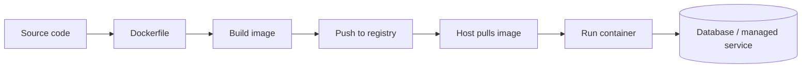
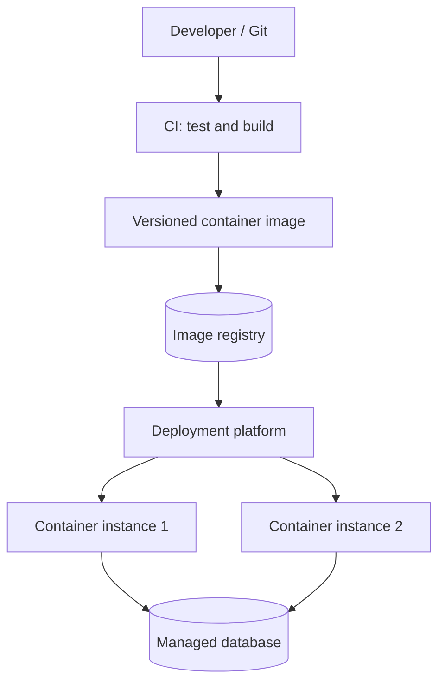
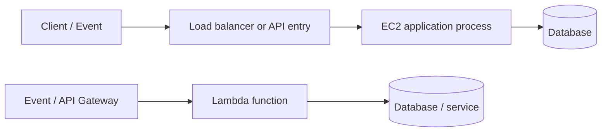
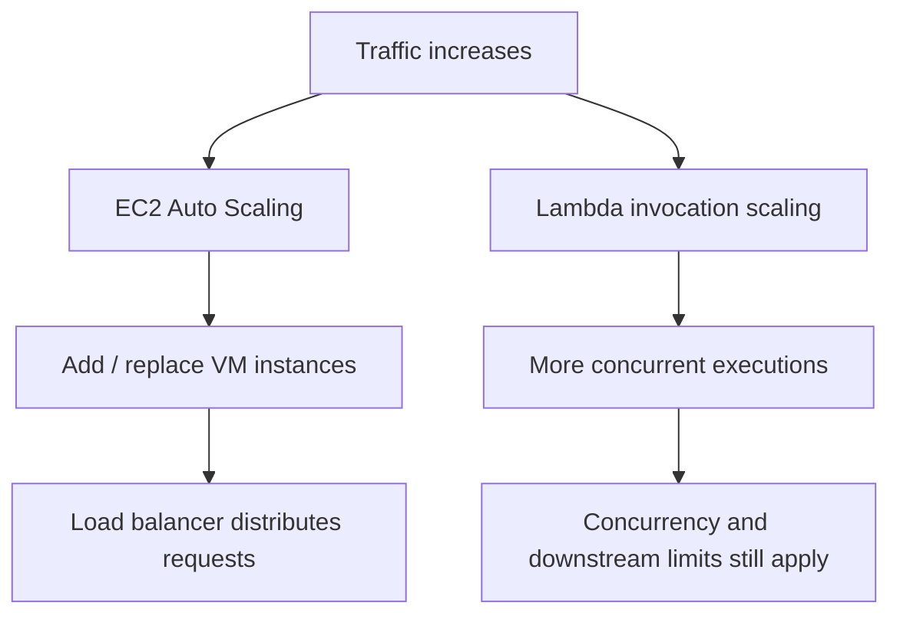

# HLD Phase 4 — Infrastructure
## Docker & Containerization • EC2 vs Lambda (Serverless vs VM)

**Purpose:** Understand how backend applications are packaged, deployed, run, scaled, and operated in production. Examples use a Node.js/Express backend.

## Phase map
1. Docker and Containerization
2. EC2 vs AWS Lambda — Virtual Machines vs Serverless

---

# 1. Docker and Containerization

## What problem does containerization solve?
An application may work on one developer's machine but fail in another environment because of differences in runtimes, operating-system libraries, dependencies, or configuration.

**Containerization packages an application and its required user-space dependencies into an image**, so it can run consistently on a compatible container runtime. Containers share the host kernel; they are not full virtual machines.

## Key terms
- **Image:** Immutable template containing application files, runtime, dependencies, and startup instructions.
- **Container:** A running instance of an image with its own process and isolated filesystem/network view.
- **Dockerfile:** Instructions for building an image.
- **Registry:** Stores and distributes images (for example, Docker Hub or Amazon ECR).
- **Volume:** Persists or shares data outside a container's writable layer.
- **Port mapping:** Connects a host port to a container port.
- **Environment variable / secret:** Runtime configuration; sensitive secrets should not be baked into images.

## Typical build-and-run flow



A production deployment commonly builds an image in CI, tags it with a version or commit SHA, pushes it to a registry, and deploys that exact image. Avoid relying on a mutable `latest` tag as the only release identifier.

## Image vs container vs VM

| Concept | What it is | Typical lifecycle |
|---|---|---|
| Image | Packaged template | Build once, store, version, distribute |
| Container | Running process created from an image | Start, stop, replace; often treated as disposable |
| Virtual machine | Virtualized machine with its own guest OS/kernel | Provision, patch, operate, replace |

Containers usually start faster and use fewer resources than full VMs, but they still need a host, runtime, resource limits, security controls, and operational monitoring.

## Example Dockerfile for Node.js
This is an illustrative baseline; pin a suitable supported Node.js image version for your project.

```dockerfile
FROM node:22-alpine

WORKDIR /app

COPY package*.json ./
RUN npm ci --omit=dev

COPY . .

ENV NODE_ENV=production
EXPOSE 3000

USER node
CMD ["node", "src/server.js"]
```

Important improvements for production:
- Use a suitable supported base image and pin versions deliberately.
- Use `.dockerignore` to exclude `.git`, `node_modules`, local `.env` files, logs, and other unnecessary files.
- Use multi-stage builds when compilation/build tooling is needed.
- Run as a non-root user where possible.
- Do not copy credentials into the image or commit them into source control.
- Keep containers stateless when practical; persist important data in managed storage or volumes.
- Add health checks at the platform/orchestrator level and handle graceful shutdown.
- Scan images, patch dependencies, and rebuild regularly.

Example `.dockerignore`:
```text
node_modules
.git
.env
.env.*
npm-debug.log
coverage
```

## Container networking and configuration
- A container's `localhost` refers to that container itself, not automatically to the host or another container.
- In Docker Compose, services can usually reach one another using service names on the shared Compose network.
- `EXPOSE 3000` documents the intended container port; it does not itself publish that port to the host.
- Pass configuration at runtime. Keep secrets in a secret manager or platform secret facility.
- A container should normally be replaceable without losing important business data.

## Persistence and deployment
A container's writable layer is generally not the right place for durable database files or user uploads. Use a managed database, object storage, or an explicitly managed volume as appropriate.

A safe deployment often follows:
1. Build and test image.
2. Scan image and dependencies.
3. Push a versioned image to registry.
4. Deploy to a staging environment.
5. Run health checks and smoke tests.
6. Roll out gradually if supported.
7. Monitor errors/latency and roll back to a known image if necessary.

## Diagram: application deployment with containers



## Docker Compose vs orchestration
- **Docker Compose:** convenient for defining and running a multi-container app, especially local development and test environments.
- **Container orchestrator:** manages deployment, placement, health, scaling, and replacement across hosts. Examples include Kubernetes and managed container platforms.
- Compose is not a full production cluster orchestrator by itself.

## Common interview questions
1. What is the difference between an image and a container?
2. Why are containers not the same as virtual machines?
3. Why should database files not live only in a container's writable layer?
4. What does `EXPOSE` do, and what does it not do?
5. How would you keep secrets out of a Docker image?
6. How would you deploy a new image and roll back safely?

---

# 2. EC2 vs AWS Lambda — Serverless vs VM

## The core distinction
- **Amazon EC2:** virtual machines you provision and manage at the instance level. You choose the OS, instance type, networking, and installed software, and you are responsible for patching and capacity configuration.
- **AWS Lambda:** runs code in response to events without you managing individual servers. AWS manages the underlying compute infrastructure, while you configure function code, runtime, permissions, triggers, memory, timeouts, and concurrency-related settings.

“Serverless” does not mean there are no servers. It means the provider manages more of the server infrastructure.

## Request flow comparison



The actual entry point varies: EC2 may sit behind an Application Load Balancer; Lambda may be invoked by API Gateway, queues, object-storage events, schedules, or other supported event sources.

## Comparison table

| Dimension | EC2 (VM-based) | Lambda (serverless functions) |
|---|---|---|
| Infrastructure management | You manage instance OS, patches, capacity, and process lifecycle | AWS manages servers; you manage function configuration and code |
| Runtime model | Long-running application process is common | Event/request-triggered function execution |
| Scaling | Configure Auto Scaling / load balancing and capacity policies | Platform scales invocations within account and function limits |
| Billing model | Pay for provisioned instance time/resources, even when underused | Generally pay for requests and execution duration/resources, subject to pricing rules |
| Execution duration | Suitable for long-running processes and services | Has a maximum execution duration; check current AWS limits for the chosen configuration |
| Startup behavior | App starts with instance/process lifecycle | May have cold-start latency; warm execution and provisioned concurrency options affect behavior/cost |
| Control | More control over OS, runtime, and host setup | Less host-level control; constrained by Lambda runtime model |
| State | Local disk/process memory exists but is not durable across replacement | Do not rely on execution environment memory or local temporary storage as durable state |
| Background work | Long-running workers and custom daemons fit naturally | Event-driven jobs fit well; long tasks may need chunking or another compute service |
| Operational burden | More OS and capacity management | Less server management, but still requires observability, security, retries, and capacity planning |

## When EC2 is a good fit
- A long-running API or worker needs persistent processes.
- You need OS-level control, custom agents, or specific runtime behavior.
- Workload is steady and predictable enough that provisioned capacity is economical.
- You have operational practices for patching, monitoring, scaling, and recovery.

## When Lambda is a good fit
- Work is naturally event-driven or bursty.
- Functions are short-lived and can be designed around the execution limits.
- You want to reduce server-management work.
- Traffic may be low or irregular, so request-based billing can be attractive.
- You can make handlers safe under retries and concurrent invocations.

## Important Lambda design considerations
- **Timeouts:** choose a timeout based on real work and dependency deadlines.
- **Retries and duplicate delivery:** events may be retried; handlers should be idempotent.
- **Concurrency:** sudden scale can overwhelm a database connection limit. Control concurrency, reuse clients where appropriate, and consider a connection proxy/pooling strategy.
- **Cold starts:** first invocation or environment initialization can add latency; measure before optimizing.
- **Observability:** use structured logs, metrics, traces, alarms, and correlation IDs.
- **Secrets and permissions:** use least-privilege IAM and a managed secret/configuration solution.
- **Networking:** placing functions in a VPC changes connectivity and setup; design outbound access and database access deliberately.
- **Long-running work:** split into steps, use a workflow/queue, or choose a compute service suited to the task.

## Scaling comparison



Neither model scales infinitely without constraints. Databases, third-party APIs, quotas, concurrency settings, and connection pools can become bottlenecks.

## Example: a Node.js notification service
- **EC2 worker:** useful for a persistent worker process consuming a queue continuously, especially when long-running processing or custom runtime behavior is needed.
- **Lambda worker:** useful when queue messages trigger independent, bounded processing tasks and retry/idempotency behavior is well designed.
- **Either approach:** store durable business state in a database, protect side effects from duplicate processing, monitor failures, and define a dead-letter/recovery strategy.

## Cost reasoning
Do not decide only by comparing headline prices. Estimate:
- Request rate and burstiness.
- Average and tail execution duration.
- CPU/memory needs.
- Idle time and baseline capacity.
- Network transfer and managed-service charges.
- Logging, monitoring, and data-store costs.
- Engineering and operational effort.

For steady high utilization, provisioned compute may be cost-effective. For intermittent, event-driven workloads, Lambda may be cost-effective. Measure with realistic workload assumptions.

## Hybrid architecture
A system can use both:
- EC2 or a container platform for the main long-running API.
- Lambda for scheduled cleanup, image processing, event handlers, or lightweight automation.
- A queue between services to absorb bursts and decouple processing.
- A managed database for durable state.

## Common interview questions
1. Explain the difference between EC2 and Lambda without saying “one has servers and one does not.”
2. What workload characteristics make Lambda a good fit?
3. Why can Lambda concurrency cause database problems?
4. How do retries affect side effects in Lambda?
5. What is a cold start, and when should you care?
6. How would you choose based on cost and operational burden?

---

# Final revision checklist

- [ ] I can explain image vs container vs VM.
- [ ] I can describe the Docker build → registry → deploy flow.
- [ ] I know why secrets and durable state should not be baked into an image/container layer.
- [ ] I can explain `EXPOSE`, port publishing, container networking, and runtime configuration.
- [ ] I can compare EC2 and Lambda across control, scaling, billing, runtime, and operations.
- [ ] I can explain cold starts, retries, idempotency, and concurrency limits.
- [ ] I can recommend a compute model for a Node.js API and a queue worker, with trade-offs.

**Completion rule:** Redraw the two diagrams from memory, explain each choice in plain language, and give one real backend example plus two trade-offs for each topic.
