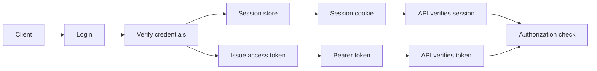
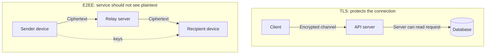
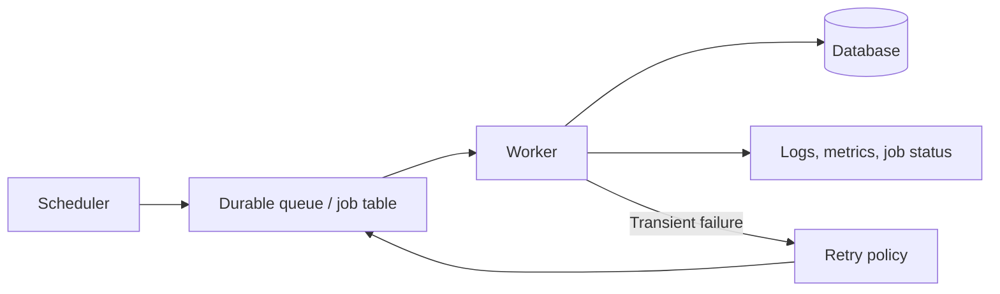
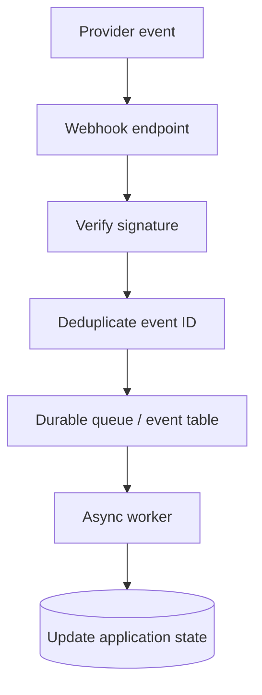
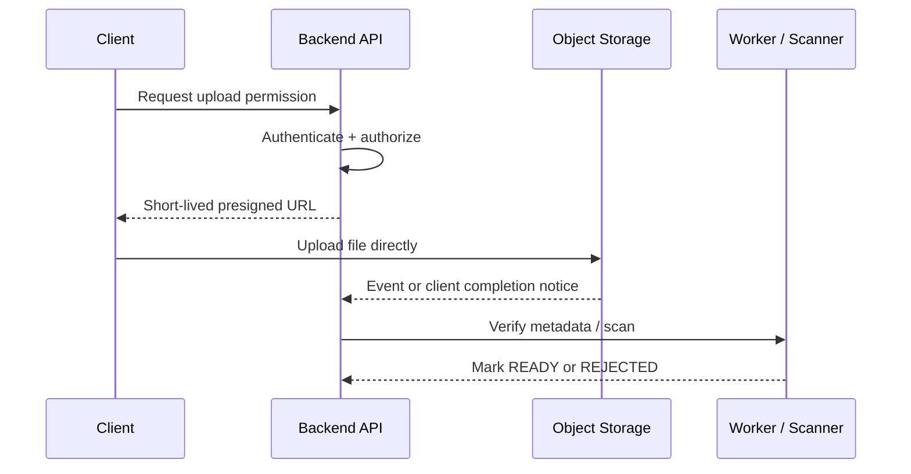

# HLD Phase 5 — Real World Addons
## Authentication, Security, Background Jobs, Webhooks, and File Uploads

**Backend context:** Node.js, Express, MongoDB, Redis, queues, and AWS S3  
**Purpose:** Understand the practical concerns that turn a working backend into a secure and reliable production system.

## Phase map
1. Authentication & Authorization — JWT, OAuth, Sessions
2. End-to-End Encryption and Security
3. Cron Jobs & Task Scheduling
4. Webhooks vs Polling
5. File Uploads — Presigned URLs, S3, Blob Storage

---

# 1. Authentication & Authorization

## Authentication vs authorization
- **Authentication (AuthN):** proves who the caller is.
- **Authorization (AuthZ):** decides what the authenticated caller is allowed to do.

Example: a user successfully signs in (authentication), but may only edit their own profile (authorization). Never treat “has a valid token” as proof that a user may access every resource.

## Sessions vs JWTs

### Server-side sessions
1. User submits credentials.
2. Server verifies them and creates a session record.
3. Browser receives an opaque session ID in a cookie.
4. Later requests send the cookie; the server looks up the session.

**Strengths:** easy central revocation, small cookie, session state stays server-side.  
**Trade-offs:** session storage and lifecycle management; distributed deployments need shared session storage or affinity considerations.

### JWT access tokens
A JWT is a token format with claims and a cryptographic signature (or MAC, depending on the algorithm). A signed JWT is typically **not encrypted**: its payload can be decoded by anyone who has the token.

A typical request:
1. User signs in.
2. Server issues a short-lived access token.
3. Client sends `Authorization: Bearer <token>`.
4. API verifies signature, issuer, audience, expiry, and relevant claims.
5. API performs authorization checks for the requested resource.

**Strengths:** can be verified without a per-request session lookup; useful across services.  
**Trade-offs:** revocation is harder before expiry; token theft is dangerous; claims can become stale; larger tokens travel with requests.

Use short access-token lifetimes and a carefully designed refresh-token strategy when needed. Rotate refresh tokens and detect reuse where supported. Store tokens safely; browser storage choices involve trade-offs. HttpOnly, Secure, appropriately configured SameSite cookies reduce some risks, but CSRF and XSS still require deliberate defenses.

## OAuth 2.0 and OpenID Connect
- **OAuth 2.0** is an authorization framework for delegated access.
- **OpenID Connect (OIDC)** adds an identity layer on top of OAuth 2.0.
- For browser/mobile user sign-in, use a supported authorization-code flow with PKCE where appropriate.
- Do not build a login protocol by hand or assume an OAuth access token is automatically an identity token.
- Validate redirect URIs, state, nonce when applicable, issuer, audience, and token signature/expiry.

## Authorization models
- **RBAC (Role-Based Access Control):** permissions are grouped into roles such as `admin`, `editor`, `viewer`.
- **ABAC (Attribute-Based Access Control):** decisions use attributes such as resource owner, tenant, time, or data classification.
- **Resource-level checks:** ensure a user can access this exact record, not just the endpoint generally.

## Password and credential basics
- Store passwords using a purpose-built password hashing function such as Argon2id, bcrypt, or scrypt with appropriate parameters and unique salts; never store plaintext passwords or use a fast general-purpose hash alone.
- Rate-limit login and recovery endpoints.
- Use secure password reset tokens with short expiry and one-time use.
- Avoid logging passwords, access tokens, refresh tokens, or session cookies.
- Apply least privilege to service identities and API credentials.

## Diagram: session vs JWT request path

## Interview checklist
- What is the difference between authentication and authorization?
- What does a JWT signature prove, and what does it not hide?
- When would you choose sessions over JWTs?
- What does OAuth do, and what does OIDC add?
- How do you stop a valid user from accessing another user's resource?

---

# 2. End-to-End Encryption and Security

## Encryption in transit, at rest, and end-to-end
- **Encryption in transit:** protects data while moving across a network, typically using TLS/HTTPS.
- **Encryption at rest:** protects stored data, such as encrypted disks, database storage, or object storage.
- **End-to-end encryption (E2EE):** content is encrypted by the sender and decrypted only by intended recipient endpoints; intermediary servers should not possess the keys needed to read the content.

These are different guarantees. HTTPS between a client and API does not automatically mean the data is end-to-end encrypted: the API usually decrypts TLS traffic and can read the request content.

## Typical TLS flow
1. Client connects to the server.
2. TLS handshake negotiates cryptographic parameters and establishes keys.
3. Client validates the server certificate and hostname.
4. Application data is protected in transit by the negotiated session keys.

TLS protects the channel; application authorization and safe data handling still matter.

## E2EE at a high level
A typical E2EE system uses authenticated public-key methods to establish or protect keys, then symmetric authenticated encryption for message content. Key verification, device changes, recovery, group membership, and metadata protection are difficult product and protocol design problems.

Important principles:
- Do not invent a cryptographic protocol; use reviewed, established protocols and libraries.
- Private keys must be protected on endpoints.
- If the server can access the plaintext or the decryption keys, the system is not truly end-to-end encrypted for that content.
- Key loss may mean data cannot be recovered; recovery features can weaken the security model.
- Encryption does not prevent screenshots, compromised devices, abusive authorized users, or all metadata leakage.

## Defense in depth
- Validate and normalize inputs; use parameterized database operations.
- Enforce authentication and resource-level authorization on every protected action.
- Use TLS, secure cookie settings, least-privilege IAM, and secret management.
- Apply rate limits and abuse detection.
- Keep dependencies patched; scan images and dependencies.
- Log security-relevant events without logging secrets or sensitive payloads.
- Back up data and test restoration; encryption alone is not a backup strategy.

## Threat-model checklist
Ask:
1. What assets need protection?
2. Who are the likely attackers?
3. What trust boundaries exist?
4. What happens if a token, device, server, or key is compromised?
5. What data is visible to the service provider?
6. How are keys rotated, revoked, backed up, and recovered?

## Diagram: TLS vs E2EE

## Interview checklist
- How is TLS different from end-to-end encryption?
- Can the server read the content in an E2EE design?
- Why should you use established cryptographic protocols?
- What security controls still matter if data is encrypted?
- What are the trade-offs around key recovery?

---

# 3. Cron Jobs & Task Scheduling

## What is a scheduled job?
A scheduled job runs work at a defined time or cadence: nightly cleanup, report generation, subscription renewal, or expiring stale records.

A cron expression commonly has five time fields: minute, hour, day of month, month, day of week. Scheduler implementations vary; verify their syntax and timezone semantics.

Example (traditional five-field cron): `0 2 * * *` means 02:00 each day in the scheduler's configured timezone.

## Scheduling is not the same as execution
A scheduler should decide **when** work is due; a worker should perform the work. For reliable systems, enqueue a job or create a durable job record rather than relying only on an in-memory timer inside one application process.

## Common architecture
1. Scheduler fires.
2. It creates a uniquely identifiable job run or enqueues work.
3. Worker claims the job.
4. Worker performs bounded work and records status.
5. Failures are retried according to policy; repeated failures become visible for investigation.

## Reliability concerns
- **Duplicate execution:** multiple instances or scheduler retries can trigger the same logical run.
- **Missed execution:** deployments, outages, or scheduler downtime may delay a run.
- **Long-running jobs:** one run may overlap the next.
- **Timezone and daylight saving:** “02:00 local time” may be ambiguous or skipped on clock changes.
- **Retries:** a retry can repeat a side effect; design idempotently.
- **Backfills:** decide whether missed runs should be skipped, caught up, or manually replayed.
- **Observability:** record scheduled time, start/end time, duration, status, attempt count, and error details.

## Idempotent scheduled work
Give each logical run a stable key such as `jobName + scheduledDate`. Use a unique database constraint or atomic claim to prevent duplicate work. For large jobs, checkpoint progress and process in batches.

## Diagram: scheduler to worker

## Interview checklist
- What if two scheduler instances fire at once?
- What happens if a job crashes halfway through?
- How are retries kept from duplicating side effects?
- How are timezones and missed runs handled?
- How can an operator safely replay a failed job?

---

# 4. Webhooks vs Polling

## Polling
A client asks a server repeatedly whether something changed.

**Advantages:** simple to implement, client controls frequency, works when callbacks are not possible.  
**Disadvantages:** repeated requests when nothing changes, update delay depends on polling interval, can create unnecessary load.

## Webhooks
A provider sends an HTTP request to your endpoint when an event occurs.

**Advantages:** lower delay and fewer idle checks for event-driven workflows.  
**Disadvantages:** your endpoint must be reachable and reliable; events can be delayed, duplicated, or delivered out of order; signatures and retries must be handled correctly.

## Webhook receiver design
1. Receive the raw request body where required by the provider's signature scheme.
2. Verify the signature using the provider's documented method and constant-time comparison where applicable.
3. Validate event identity, timestamp/replay rules, and expected account/resource.
4. Persist the event or enqueue it durably.
5. Return a success response quickly after durable acceptance.
6. Process asynchronously and idempotently.
7. Monitor retries, failures, and dead-letter events.

Do not trust a webhook just because it came to a hard-to-guess URL. Verify authenticity and authorization.

## Delivery semantics
Most webhook providers retry if they do not receive a timely successful response. This can produce duplicate delivery. Use a provider event ID with a unique constraint or deduplication record. Do not assume arrival order matches event order; use event timestamps or fetch canonical current state when necessary.

## Polling vs webhook decision
- Use webhooks when the provider supports reliable event callbacks and low-latency updates matter.
- Use polling when the provider lacks webhooks, when periodic reconciliation is necessary, or when simplicity is sufficient.
- Many robust systems use **webhooks plus reconciliation polling** to recover missed events.

## Diagram: webhook processing

## Interview checklist
- Why should webhook processing be asynchronous?
- How do you validate that a webhook is authentic?
- How do you handle duplicate and out-of-order events?
- When is polling still useful?
- Why might a reconciliation poller be valuable even with webhooks?

---

# 5. File Uploads — Presigned URLs, S3, Blob Storage

## Two common upload patterns

### Upload through the backend
1. Client sends file to API.
2. API validates and streams the file to object storage.
3. API records metadata and returns the result.

**Pros:** central control and easy to apply business checks in the request path.  
**Cons:** API bandwidth, memory/CPU, connection time, and scaling costs are used for the file transfer.

### Direct upload with a presigned URL
1. Client asks backend for an upload permission.
2. Backend authenticates/authorizes the user and creates a short-lived presigned URL for a specific object/key and allowed operation.
3. Client uploads directly to object storage.
4. Client notifies backend or backend receives a storage event.
5. Backend verifies the object and marks it ready.

The file bytes bypass the application server, reducing API load. The backend must still enforce who can upload, which key can be used, and whether the uploaded object is acceptable.

## Presigned URL security
- Keep expiry short and scope the URL to the intended operation/object.
- Treat the URL like a bearer credential while valid; do not log or expose it unnecessarily.
- Use unique object keys; avoid letting clients overwrite arbitrary objects.
- Enforce size/type constraints as supported by the upload mechanism and verify after upload.
- Configure bucket policies, least-privilege IAM, encryption, and appropriate CORS.
- Do not trust the filename extension or client-provided MIME type alone.
- Scan files where the threat model requires it; consider quarantining before making content available.
- Never assume a successful upload means the file is safe.

## Metadata and lifecycle
Store metadata in the application database: owner, object key, size, content type, checksum where available, status, creation time, and moderation/scan status. Store file bytes in object storage rather than embedding large files in ordinary application records.

Common lifecycle:
`PENDING_UPLOAD → UPLOADED → SCANNING → READY` or `REJECTED`.

Use lifecycle policies for temporary uploads, old versions, and retention where appropriate. Design cleanup for abandoned multipart uploads and incomplete records.

## S3 and blob storage
Amazon S3 is object storage: objects are addressed by bucket and key. Other cloud platforms offer analogous blob/object storage services. It is not a traditional mounted filesystem, and object operations, access controls, and consistency guarantees should be understood from the chosen provider's documentation.

## Diagram: direct presigned upload

## Interview checklist
- Why use a presigned URL rather than proxying every upload through Express?
- What does the backend need to authorize before issuing a URL?
- Why are file extensions and MIME types insufficient validation?
- How do you prevent arbitrary overwrites and public exposure?
- How should the application handle an upload that never completes?

---

# Final revision sheet

| Problem | Pattern | Important caveat |
|---|---|---|
| Prove who is calling | Session, token, OIDC login | Authentication does not imply resource authorization |
| Protect data in transit | TLS/HTTPS | TLS is not automatically end-to-end encryption |
| Protect content from intermediaries | Reviewed E2EE protocol | Key recovery and device compromise remain hard problems |
| Run work at a cadence | Scheduler + durable queue/job record | Duplicate, missed, or overlapping runs can happen |
| React to external events | Signed webhook + durable async processing | Retries, duplicates, and out-of-order delivery |
| Handle large uploads | Short-lived presigned URL + object storage | Validate, scan, and authorize the resulting object |

## Quick self-test
1. Explain authentication vs authorization.
2. What is visible inside a signed JWT?
3. What does OIDC add to OAuth 2.0?
4. How is TLS different from E2EE?
5. How can a scheduled job avoid duplicate execution?
6. Why should a webhook receiver respond quickly after durable acceptance?
7. How do you authenticate and deduplicate webhook events?
8. Why are presigned URLs useful for large files?
9. How would you quarantine and scan a newly uploaded object?
10. What would you log for an upload or scheduled-job failure without exposing secrets?

**Completion criterion:** Redraw the diagrams, explain one practical Node.js example per topic, and name at least two security or reliability trade-offs for each.
